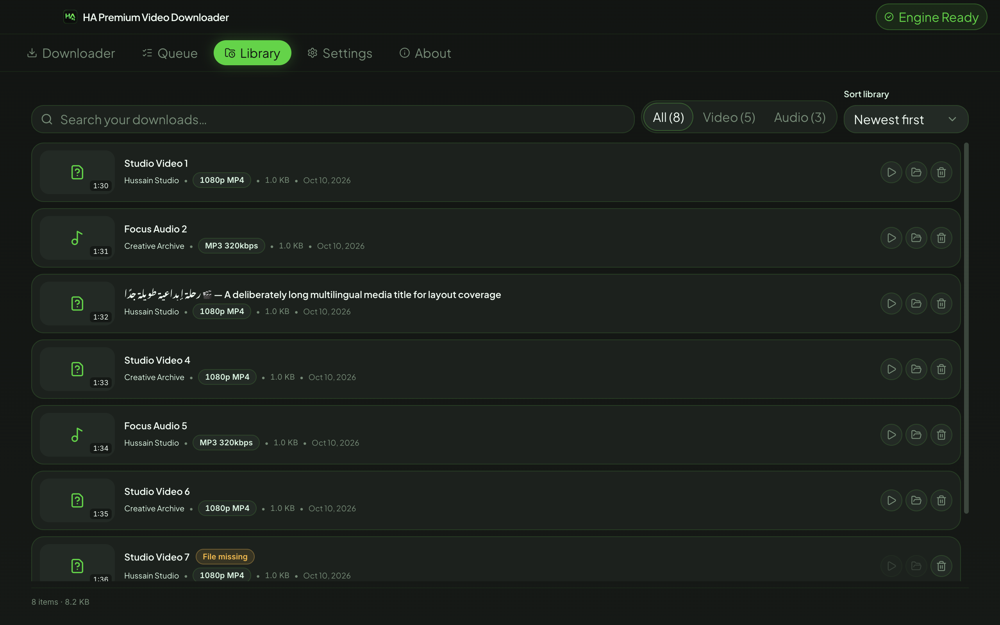
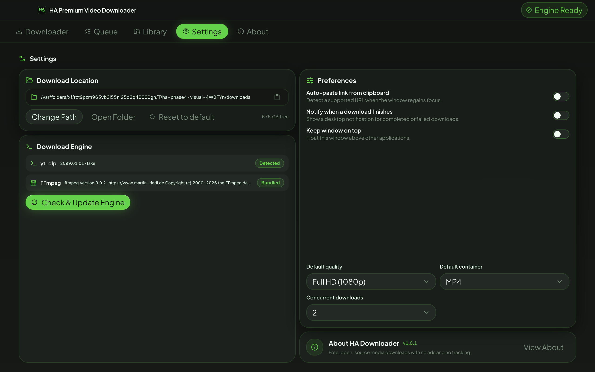
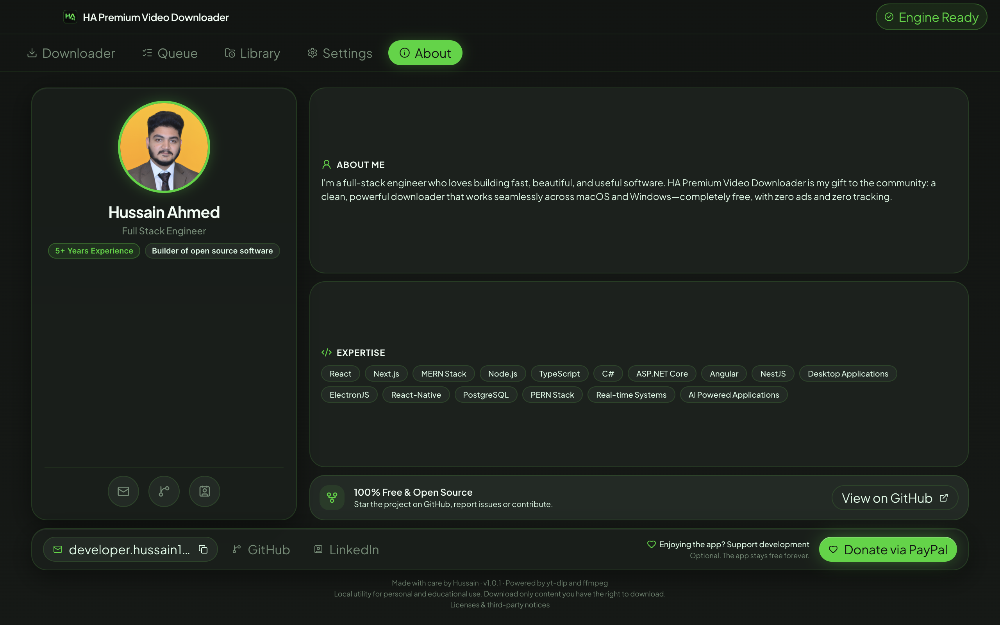

<p align="center">
  
</p>

<h1 align="center">HA Premium Video Downloader</h1>

<p align="center">A private desktop home for reliable video and audio downloads.</p>

<p align="center">
  
  
  
  
</p>

> **Disclaimer.** HA Premium Video Downloader is a local utility intended for personal and educational use. It does not host, store, or distribute any content. You are responsible for making sure you have the right to download any content, and for complying with the terms of the sites you use and with applicable copyright law. The developer accepts no liability for misuse. This project is not affiliated with or endorsed by YouTube, Google, or any other platform, nor by the yt-dlp or FFmpeg projects.

> [!IMPORTANT]
> The 1.0.1 release candidate is feature-complete. Intel macOS automation is
> verified locally; Apple Silicon and Windows hardware checklists remain before
> a public release is published.


## Why this exists

HA Premium Video Downloader is a free, focused alternative to ad-heavy download sites. It keeps work on your computer, without accounts, analytics, or tracking. The download engine is based on the excellent [yt-dlp](https://github.com/yt-dlp/yt-dlp) and [FFmpeg](https://ffmpeg.org/) projects. The interface exists to make those tools approachable without hiding what they do.

## Features

- ✅ Secure Electron shell with isolated, sandboxed renderer processes
- ✅ Responsive native-feeling macOS and Windows chrome
- ✅ Local fonts, semantic design tokens, and accessible UI primitives
- ✅ Keyboard tab navigation and reduced-motion support
- ✅ Real yt-dlp probing, format selection, size estimation, and friendly errors
- ✅ Source-gated video qualities up to 8K (4320p), with MP4 and MKV output
- ✅ Fast macOS engine startup after first-run preparation, with short-lived preview reuse for downloads
- ✅ Persistent concurrent queue with pause, resume, retry, scoped cancellation, and recovery
- ✅ Atomic settings/history/queue stores and on-demand engine updates
- ✅ Typed, zod-validated IPC plus deterministic and live real-binary coverage
- ✅ Real Downloader preview, available formats, size estimates, folder choice, and audio mode
- ✅ Live Queue controls, recovery, progress, speed/ETA, completion actions, and failure retry
- ✅ Searchable, sortable, virtualized Library with missing-file and safe delete handling
- ✅ Persistent Settings with real engine checks, live preferences, and folder validation
- ✅ Local About profile, allowlisted links, copy-email feedback, real version, and legal copy
- ✅ Native notifications, close/resume protection, single-instance focus, window persistence, drag/drop, and shortcuts
- ✅ Separate native Intel and Apple Silicon macOS package inputs and Windows x64 installer configuration
- ✅ Redacted diagnostics, packaged licenses, GPL notices, and release documentation
- 🚧 Code signing/notarization and final cross-hardware sign-off

## Screenshots

These screenshots are generated by the Electron Playwright suite from real renderer states at the supported window sizes. No sample downloads or storage figures ship in the UI.

| Queue                                                 | Library                                               |
| ----------------------------------------------------- | ----------------------------------------------------- |
|  |  |

| Settings                                                      | About                                         |
| ------------------------------------------------------------- | --------------------------------------------- |
|  |  |

## Install

There is no public release yet. Release candidates are unsigned. macOS builds
produce separate x64 and arm64 DMGs; the arm64 package needs physical Apple
Silicon verification. The Windows x64 installer is built and verified on
Windows, not cross-built on macOS.

### Which macOS file should I download?

Open **Apple menu → About This Mac** and look for **Chip** or **Processor**.
Do not choose only by the Mac's year because Apple sold Intel and Apple Silicon
models at the same time during the transition.

| What About This Mac shows                  | Correct download                                      | Typical computers                                                               |
| ------------------------------------------ | ----------------------------------------------------- | ------------------------------------------------------------------------------- |
| **Chip: Apple M1, M2, M3, M4, or newer**   | `HA-Premium-Video-Downloader-<version>-mac-arm64.dmg` | Apple Silicon MacBook Air, MacBook Pro, Mac mini, iMac, Mac Studio, and Mac Pro |
| **Processor: Intel Core i5, i7, i9, etc.** | `HA-Premium-Video-Downloader-<version>-mac-x64.dmg`   | Intel MacBook, MacBook Air, MacBook Pro, Mac mini, iMac, iMac Pro, and Mac Pro  |

`mac-arm64.dmg` is the native and recommended build for Apple Silicon. The x64
build can run on an Apple Silicon Mac through Rosetta, but it is intended for
Intel Macs and is not the preferred download for an M-series Mac.

For a local unsigned macOS build, open the DMG and drag the app to Applications. If version 1.0.0 is already installed, choose **Replace**; the build command itself does not change the installed app or your downloads. On first launch, right-click the app and choose **Open**. If macOS still blocks it, run:

```sh
xattr -cr "/Applications/HA Premium Video Downloader.app"
```

Future unsigned Windows builds may trigger SmartScreen; choose **More info**, then **Run anyway** only for an artifact you built or obtained from a trusted source.

## Quick start

Paste or drop a video/audio link into Downloader. Once the preview is ready, choose video quality and container—or switch to audio format and bitrate—then select a save folder and add it to Queue. Completed files appear in Library, while Settings controls defaults, concurrency, notifications, clipboard behavior, and window priority.

8K appears only when the source exposes a genuine 4320p stream. These files can be very large, and AV1/VP9 playback support depends on the selected container and your media player; the app merges the original streams without silently re-encoding them.

| Shortcut               | Action                                              |
| ---------------------- | --------------------------------------------------- |
| `Cmd/Ctrl + 1…5`       | Open Downloader, Queue, Library, Settings, or About |
| `Cmd/Ctrl + L`         | Open Downloader and focus its link field            |
| `Cmd/Ctrl + V`         | Paste a link while Downloader is active             |
| `Cmd/Ctrl + Enter`     | Enqueue and keep the current link                   |
| `Cmd/Ctrl + ,`         | Open Settings                                       |
| `Cmd/Ctrl + Shift + U` | Toggle the UI kit in development builds             |

## Supported sites

Site support will follow the installed yt-dlp engine. See the upstream [supported-sites list](https://github.com/yt-dlp/yt-dlp/blob/master/supportedsites.md), and remember that individual sites can change without notice.

## Build from source

Build macOS packages on macOS and the Windows installer on Windows. Do not
cross-build the Windows installer from a Mac. All package versions are
exact-pinned, and the native yt-dlp/FFmpeg files are intentionally not stored
in Git.

### Requirements

- [Git](https://git-scm.com/downloads)
- [Node.js 24 LTS](https://nodejs.org/) with npm 11 or newer
- About 2 GB of free space for dependencies and package output
- Network access on the first macOS build to fetch the official, checksum-verified unpackaged yt-dlp runtime (about 51 MB compressed)
- The yt-dlp and FFmpeg files described below

Confirm the Node and npm versions before continuing:

```sh
node --version
npm --version
```

`node --version` must show `v24.x.x`. Clone the repository, enter it, and
install the exact locked dependencies:

```sh
git clone https://github.com/hussainislive/HA-VideoDownloader.git
cd HA-VideoDownloader
npm ci
```

### Binary paths

You do **not** need to add yt-dlp or FFmpeg to the operating system `PATH`.
Place them in these exact repository folders; the app and packaging scripts
resolve them automatically:

```text
HA-VideoDownloader/
└── binaries/
    ├── macos-x64/
    │   ├── yt-dlp
    │   └── ffmpeg
    ├── macos-arm64/
    │   ├── yt-dlp
    │   └── ffmpeg
    └── win/
        ├── yt-dlp.exe
        └── ffmpeg.exe
```

There is no `binaries/macos/` fallback. Names and capitalization must match
the tree exactly. Never commit these binary files.

### Create macOS builds

The Mac build can create both DMGs on either an Intel or Apple Silicon Mac.
Download:

1. The universal `yt-dlp_macos` file from the
   [official yt-dlp release page](https://github.com/yt-dlp/yt-dlp/releases).
   Rename it to `yt-dlp` and place an identical copy in both macOS folders.
2. The matching Intel/x86_64 and Apple Silicon/arm64 FFmpeg archives from
   [Martin Riedl's static FFmpeg builds](https://ffmpeg.martin-riedl.de/).
   Extract the `ffmpeg` executable from each archive into its matching folder.
3. `yt-dlp.exe` from the official yt-dlp release page and the Windows x64
   `ffmpeg.exe` essentials build linked from the
   [official FFmpeg Windows download page](https://ffmpeg.org/download.html#build-windows).
   The macOS verifier checks these Windows inputs statically as part of the
   complete release-binary audit.

Create the folders and copy previously downloaded files from Terminal. Replace
the example `/path/to/...` values with their real locations:

```sh
mkdir -p binaries/macos-x64 binaries/macos-arm64 binaries/win

cp /path/to/yt-dlp_macos binaries/macos-x64/yt-dlp
cp /path/to/yt-dlp_macos binaries/macos-arm64/yt-dlp
cp /path/to/x64/ffmpeg binaries/macos-x64/ffmpeg
cp /path/to/arm64/ffmpeg binaries/macos-arm64/ffmpeg
cp /path/to/yt-dlp.exe binaries/win/yt-dlp.exe
cp /path/to/ffmpeg.exe binaries/win/ffmpeg.exe

chmod +x binaries/macos-x64/yt-dlp binaries/macos-x64/ffmpeg
chmod +x binaries/macos-arm64/yt-dlp binaries/macos-arm64/ffmpeg
xattr -dr com.apple.quarantine binaries
```

The `binaries/macos-*` yt-dlp files remain the verified fallback inputs. For
fast normal use, `npm run dist:mac:*` also downloads the official
`yt-dlp_macos.zip` release into ignored `.cache/mac-runtime/`, checks its pinned
SHA-256, and packages its unpacked runtime. You can prepare it ahead of time:

```sh
npm run prepare:mac-runtime
```

This does not edit `binaries/` or require Python to be installed separately.
On an offline development launch, the app can fall back to the original slower
executable; a release build requires the verified fast runtime.

Verify the files and run the release gate:

```sh
npm run verify:binaries
npm run check
```

Build both macOS packages:

```sh
npm run dist:mac
```

Or build only one architecture:

```sh
npm run dist:mac:x64    # Intel Macs
npm run dist:mac:arm64  # Apple Silicon M-series Macs
```

The finished files are written to `release/`:

```text
release/HA-Premium-Video-Downloader-<version>-mac-x64.dmg
release/HA-Premium-Video-Downloader-<version>-mac-arm64.dmg
```

Each DMG contains only its matching FFmpeg architecture. Test the x64 DMG on an
Intel Mac and the arm64 DMG on an Apple Silicon Mac before publishing them.
On a fresh macOS installation, the first engine preparation can take longer
while macOS checks the new native runtime. Later launches reuse its writable
copy. Site response times still vary; a fast connection alone cannot guarantee
every preview in two or three seconds.

### Create the Windows build

Use a 64-bit Windows 10 or Windows 11 computer. Download `yt-dlp.exe` from the
[official yt-dlp releases](https://github.com/yt-dlp/yt-dlp/releases). Download
the Windows x64 FFmpeg essentials archive through the
[official FFmpeg Windows page](https://ffmpeg.org/download.html#build-windows),
extract it, and locate `bin\ffmpeg.exe` inside the extracted folder.

From PowerShell in the repository, create the binary folder and copy the two
files. Replace the example source paths with the real downloaded locations:

```powershell
New-Item -ItemType Directory -Force binaries\win
Copy-Item "C:\path\to\yt-dlp.exe" "binaries\win\yt-dlp.exe"
Copy-Item "C:\path\to\ffmpeg\bin\ffmpeg.exe" "binaries\win\ffmpeg.exe"
```

Install dependencies, verify the Windows binaries, and run the release gate:

```powershell
npm ci
npm run verify:binaries
npm run check
```

Create the Windows x64 installer:

```powershell
npm run dist:win
```

The installer is written to:

```text
release\HA-Premium-Video-Downloader-<version>-win-x64.exe
```

It is a per-user installer with an install-folder choice plus Desktop and Start
Menu shortcuts. Because local builds are unsigned, Windows SmartScreen may
show a warning. Bypass it only for an installer you built yourself and after
Windows Defender reports no malware detection.

### Build a new version

To produce filenames with a new version number, update `package.json` and
`package-lock.json` together before building. For example:

```sh
npm version 1.0.1 --no-git-tag-version
npm run check
```

Then run `npm run dist:mac` on macOS and `npm run dist:win` on Windows. The
artifact filenames automatically use the version from `package.json`. Generated
`out/` and `release/` directories must not be committed.

## Project structure

```text
src/main/          Electron lifecycle, security, IPC, and native window
src/preload/       Narrow contextBridge API
src/renderer/      React shell, tokens, primitives, and feature screens
src/shared/        Pure types, schemas, and utilities
tests/unit/        Vitest unit and component coverage
tests/e2e/         Playwright Electron, axe, and visual coverage
scripts/           Binary verification, design rendering, packaging hooks
docs/              Architecture, testing, performance, release, and QA guides
```

See [`docs/ARCHITECTURE.md`](docs/ARCHITECTURE.md) for the process boundaries and data flow.

## Tech stack

| Area                 | Choice                                        |
| -------------------- | --------------------------------------------- |
| Desktop              | Electron 44.7.0 + electron-vite 5.0.0         |
| UI                   | React 19.3.0 + TypeScript 6.0.3               |
| Styling              | Tailwind CSS 4.3.3 + Motion 13.4.4            |
| State and validation | Zustand 5.0.15 + zod 4.6.5                    |
| Tests                | Vitest 5.0.2 + Playwright 1.64.0 + axe 4.13.0 |
| Packaging            | electron-builder 26.15.3                      |

The complete resolved table and compatibility notes live in [`docs/STACK.md`](docs/STACK.md).

## Testing

```sh
npm test             # unit and component tests
npm run test:e2e     # production build + deterministic Electron tests
npm run check        # complete required quality gate
npm run test:e2e:live # opt-in real-engine tests, including the three owner-supplied links
npm run test:e2e:performance # finite release performance suite
```

Electron E2E drives the complete visual flow with real IPC and filesystem output, including progress, completion, pause/resume/cancel, retry, audio extraction, accessibility, responsive snapshots, and recovery. Opt-in macOS live tests include a real end-to-end UI download using the bundled tools and a documented Creative Commons fixture. More detail is in [`docs/TESTING.md`](docs/TESTING.md).

## Roadmap and project status

- **Phase 1 — complete:** foundation, secure shell, design system, tooling, tests, and packaging
- **Phase 2 — complete:** engine, queue state machine, persistence, IPC, fake engine, and live binary tests
- **Phase 3 — complete:** functional Downloader and Queue screens, responsive visuals, and live UI smoke
- **Phase 4 — complete:** Library, Settings, About, system integration, and resilience coverage
- **Phase 5 — release candidate:** hardening, native macOS packaging, GPL/release preparation, and conservative Intel performance baseline complete; external platform sign-off remains

Later ideas such as playlists, subtitles, browser cookies, telemetry, and automatic app updates are intentionally outside v1.

## Troubleshooting and FAQ

**Which macOS build should I use?** In **Apple menu → About This Mac**, “Chip:
Apple M…” means arm64 and “Processor: Intel…” means x64. Apple Silicon can run
the x64 build through Rosetta, but the arm64 build is the recommended native
choice.

**Why does the app say “Engine problem”?** The title-bar status is live. Open Settings for detected versions and the engine repair action. In a source checkout, run `npm run verify:binaries` or replace a missing/incompatible owner-supplied binary.

**Why might a link still take a few seconds?** The app no longer pays the old
26–28-second macOS yt-dlp startup cost on every action. It reuses the preview
for the first download attempt, but each website still controls how quickly it
responds, and audio conversion or metadata embedding takes real time. Queue
shows **Preparing source…** until actual transfer progress arrives. If a
cached media URL expires, the app retries the ordinary link once.

**Why is a Library row marked “File missing”?** History is preserved when a downloaded file is moved or deleted outside the app. Play and Open Location stay disabled until the entry is removed or the file is restored.

**Why is the app unsigned?** Signing and notarization require owner credentials and certificates. The current packages are release-candidate artifacts; verify their published SHA-256 before bypassing an OS warning.

**How do I report a problem?** Choose **Help → Copy diagnostic info** and paste
the redacted result into the bug template. Do not share private media URLs,
cookies, tokens, or downloaded content.

**Where are licenses and logs?** Help → Licenses opens the packaged notices;
Help → Open logs folder reveals the rotating local logs. No telemetry is sent.

## Contributing

Please read [`CONTRIBUTING.md`](CONTRIBUTING.md) and the
[`CODE_OF_CONDUCT.md`](CODE_OF_CONDUCT.md). Open a focused issue before a large
change and run `npm run check` before submitting a pull request.

## Legal notice

**Disclaimer.** HA Premium Video Downloader is a local utility intended for personal and educational use. It does not host, store, or distribute any content. You are responsible for making sure you have the right to download any content, and for complying with the terms of the sites you use and with applicable copyright law. The developer accepts no liability for misuse. This project is not affiliated with or endorsed by YouTube, Google, or any other platform, nor by the yt-dlp or FFmpeg projects.

See [`THIRD_PARTY_NOTICES.md`](THIRD_PARTY_NOTICES.md) for dependency,
engine-license, build-flag, and corresponding-source details.

## Acknowledgements

Built with yt-dlp, FFmpeg, Electron, React, Tailwind CSS, Motion, Lucide, Zustand, zod, Vitest, and Playwright.

## License

Copyright © 2026 Hussain Ahmed. This program is free software: you can
redistribute it and/or modify it under the terms of the GNU General Public
License as published by the Free Software Foundation, either version 3 of the
License, or (at your option) any later version. This program is distributed
without any warranty. See [`LICENSE`](LICENSE) for the complete terms.

## About the developer

Created by **Hussain Ahmed**. Find him on [GitHub](https://github.com/hussainislive) and [LinkedIn](https://www.linkedin.com/in/hussainislive/), email [developer.hussain125@gmail.com](mailto:developer.hussain125@gmail.com), or [support the work](https://paypal.me/hussainmeer).
