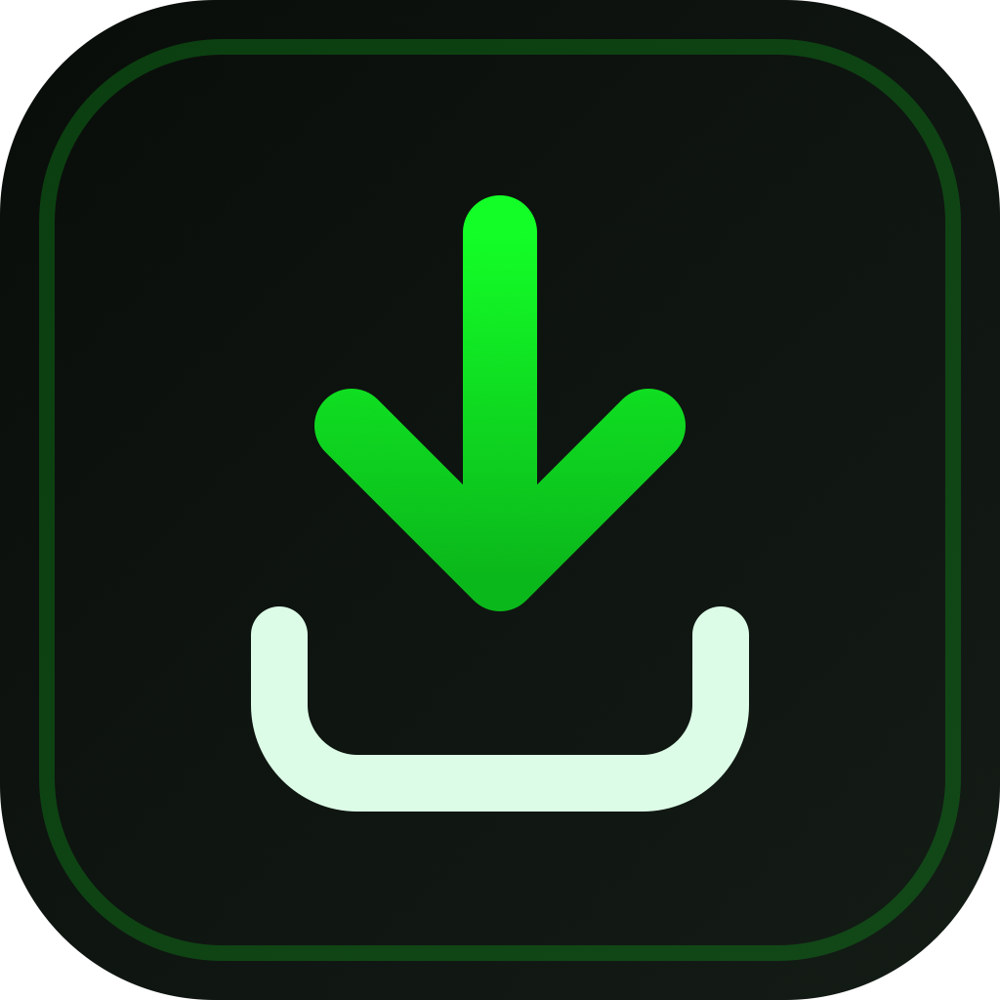
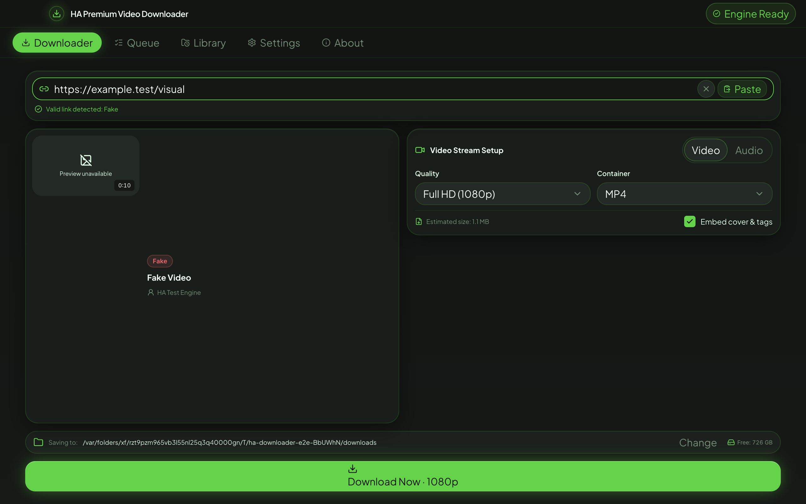
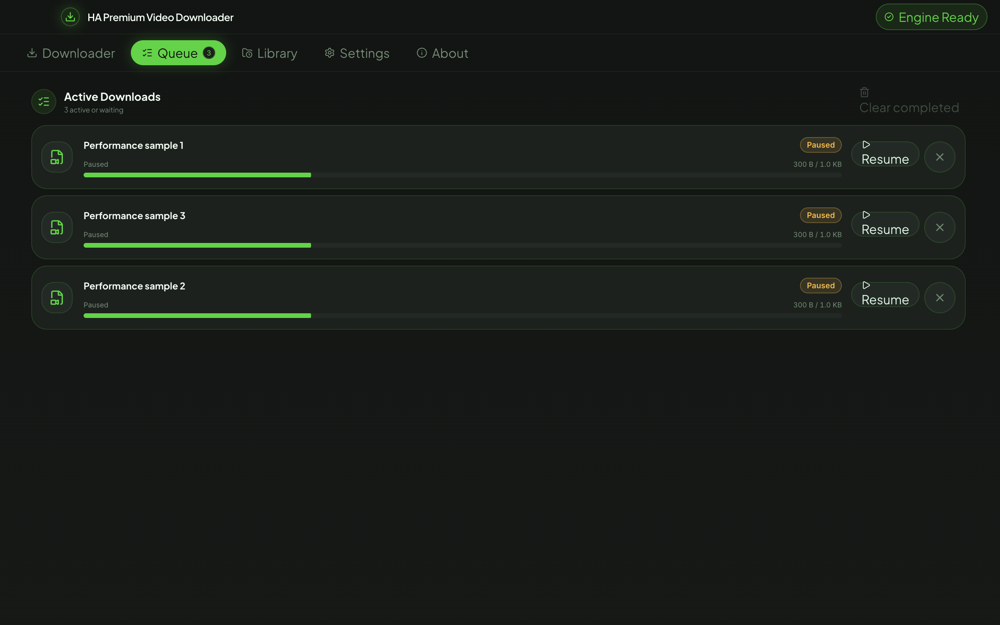

<p align="center">
  
</p>

<h1 align="center">HA Premium Video Downloader</h1>

<p align="center">A private desktop home for reliable video and audio downloads.</p>

<p align="center">
  
  
  
  
</p>

> [!IMPORTANT]
> This repository is at Phase 3. The Downloader and Queue are fully wired to the real engine. Library, Settings, and About arrive in Phase 4.





## Why this exists

HA Premium Video Downloader is being built as a free, focused alternative to ad-heavy download sites. It will keep work on your computer, without accounts, analytics, or tracking. The download engine is based on the excellent [yt-dlp](https://github.com/yt-dlp/yt-dlp) and [FFmpeg](https://ffmpeg.org/) projects. The interface exists to make those tools approachable without hiding what they do.

## Features

- ✅ Secure Electron shell with isolated, sandboxed renderer processes
- ✅ Responsive native-feeling macOS and Windows chrome
- ✅ Local fonts, semantic design tokens, and accessible UI primitives
- ✅ Keyboard tab navigation and reduced-motion support
- ✅ Real yt-dlp probing, format selection, size estimation, and friendly errors
- ✅ Persistent concurrent queue with pause, resume, retry, scoped cancellation, and recovery
- ✅ Atomic settings/history/queue stores and on-demand engine updates
- ✅ Typed, zod-validated IPC plus deterministic and live real-binary coverage
- ✅ Real Downloader preview, available formats, size estimates, folder choice, and audio mode
- ✅ Live Queue controls, recovery, progress, speed/ETA, completion actions, and failure retry
- 🚧 Library, Settings, and About screen interactions
- 🚧 Signed release artifacts (unsigned development packages only today)

## Screenshots

These screenshots are generated by the Electron Playwright suite from real renderer states at the supported window sizes. No sample downloads or storage figures ship in the UI.

## Install

There is no public release yet. Phase 1 produces an unsigned Intel-compatible macOS DMG locally; Windows and native Apple Silicon packages still need platform-specific verification and a native arm64 FFmpeg build.

For a local unsigned macOS build, open the DMG and drag the app to Applications. On first launch, right-click the app and choose **Open**. If macOS still blocks it, run:

```sh
xattr -cr "/Applications/HA Premium Video Downloader.app"
```

Future unsigned Windows builds may trigger SmartScreen; choose **More info**, then **Run anyway** only for an artifact you built or obtained from a trusted source.

## Quick start

Paste or drop a video/audio link into Downloader. Once the preview is ready, choose video quality and container—or switch to audio format and bitrate—then select a save folder and add it to Queue. Queue supports pause, resume, cancel, retry, open, play, copy-path, and completed-item cleanup.

| Shortcut               | Action                                              |
| ---------------------- | --------------------------------------------------- |
| `Cmd/Ctrl + 1…5`       | Open Downloader, Queue, Library, Settings, or About |
| `Cmd/Ctrl + L`         | Open Downloader                                     |
| `Cmd/Ctrl + V`         | Paste a link while Downloader is active             |
| `Cmd/Ctrl + Enter`     | Enqueue and keep the current link                   |
| `Cmd/Ctrl + ,`         | Open Settings                                       |
| `Cmd/Ctrl + Shift + U` | Toggle the UI kit in development builds             |

## Supported sites

Site support will follow the installed yt-dlp engine. See the upstream [supported-sites list](https://github.com/yt-dlp/yt-dlp/blob/master/supportedsites.md), and remember that individual sites can change without notice.

## Build from source

Prerequisites:

- Node.js 24 LTS and npm 11+
- macOS or Windows
- The platform binaries described in [`binaries/README.md`](binaries/README.md)

```sh
npm install
npm run verify:binaries
npm run dev
npm run check
npm run dist:mac   # macOS x64 with the currently supplied FFmpeg
# npm run dist:win # Windows x64; requires Windows verification
```

All package versions are exact-pinned. Do not commit the binary payloads or generated `out/` and `release/` directories.

## Project structure

```text
src/main/          Electron lifecycle, security, IPC, and native window
src/preload/       Narrow contextBridge API
src/renderer/      React shell, tokens, primitives, and feature screens
src/shared/        Pure types, schemas, and utilities
tests/unit/        Vitest unit and component coverage
tests/e2e/         Playwright Electron, axe, and visual coverage
scripts/           Binary verification, design rendering, packaging hooks
docs/              Architecture, decisions, testing, and progress
```

See [`docs/ARCHITECTURE.md`](docs/ARCHITECTURE.md) for the process boundaries and data flow.

## Tech stack

| Area                 | Choice                                        |
| -------------------- | --------------------------------------------- |
| Desktop              | Electron 44.7.0 + electron-vite 5.0.0         |
| UI                   | React 19.3.0 + TypeScript 6.0.3               |
| Styling              | Tailwind CSS 4.3.3 + Motion 13.4.4            |
| State and validation | Zustand 5.0.15 + zod 4.6.5                    |
| Tests                | Vitest 5.0.2 + Playwright 1.64.0 + axe 4.13.0 |
| Packaging            | electron-builder 26.15.3                      |

The complete resolved table and compatibility notes live in [`docs/STACK.md`](docs/STACK.md).

## Testing

```sh
npm test             # unit and component tests
npm run test:e2e     # production build + deterministic Electron tests
npm run check        # complete required quality gate
npm run test:e2e:live # opt-in real-engine tests; introduced in Phase 2
```

Electron E2E drives the complete visual flow with real IPC and filesystem output, including progress, completion, pause/resume/cancel, retry, audio extraction, accessibility, responsive snapshots, and recovery. Opt-in macOS live tests include a real end-to-end UI download using the bundled tools and a documented Creative Commons fixture. More detail is in [`docs/TESTING.md`](docs/TESTING.md).

## Roadmap and project status

- **Phase 1 — complete:** foundation, secure shell, design system, tooling, tests, and packaging
- **Phase 2 — complete:** engine, queue state machine, persistence, IPC, fake engine, and live binary tests
- **Phase 3 — complete:** functional Downloader and Queue screens, responsive visuals, and live UI smoke
- **Phase 4:** Library, Settings, and About screens
- **Phase 5:** performance, recovery, cross-platform QA, signing hooks, and release polish

Later ideas such as playlists, subtitles, browser cookies, telemetry, and automatic app updates are intentionally outside v1.

## Troubleshooting and FAQ

**Why does the current macOS build use x64?** The supplied yt-dlp is universal, but the supplied FFmpeg is x86_64-only. A native arm64 package would falsely advertise native support, so packaging remains x64 until a verified arm64 FFmpeg is supplied.

**Why does the app say “Engine problem”?** The title-bar status is live. Run `npm run verify:binaries` in a source checkout, or replace a missing/incompatible owner-supplied binary. Phase 4 adds the detailed Settings diagnostics and repair controls.

**Why is the app unsigned?** Signing and notarization require owner credentials and certificates. The current package is a development artifact.

**Where are the logs?** Phase 1 initializes local rotating logs. The in-app diagnostics action arrives with Settings; no telemetry is sent.

## Contributing

The contributor guide is scheduled for Phase 5. Until then, please open a focused issue before starting a substantial change and keep work within the current phase.

## Legal notice

Download only content you have the right to download. You are responsible for complying with the terms of the sites you use and with local copyright law.

This project is not affiliated with yt-dlp, FFmpeg, or supported websites. See [`THIRD_PARTY_NOTICES.md`](THIRD_PARTY_NOTICES.md) for current dependency and binary notices.

## Acknowledgements

Built with yt-dlp, FFmpeg, Electron, React, Tailwind CSS, Motion, Lucide, Zustand, zod, Vitest, and Playwright.

## License

The application source currently carries an MIT placeholder license. The owner must confirm that choice before public release. Bundled tools retain their own licenses; the supplied FFmpeg is GPL-enabled.

## About the developer

Created by **Hussain Ahmed**. Find him on [GitHub](https://github.com/hussainislive) and [LinkedIn](https://www.linkedin.com/in/hussainislive/), email [developer.hussain125@gmail.com](mailto:developer.hussain125@gmail.com), or [support the work](https://paypal.me/hussainmeer).
