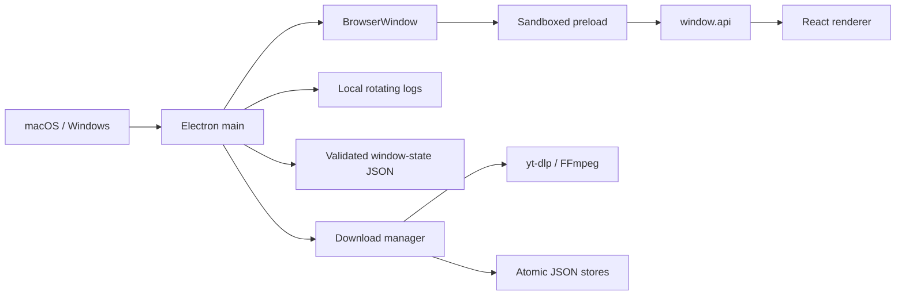
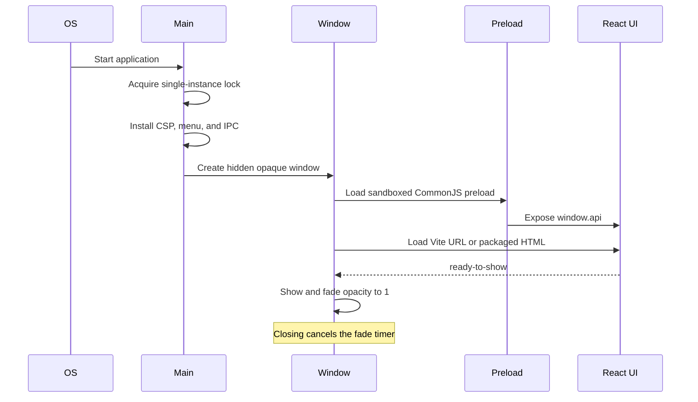
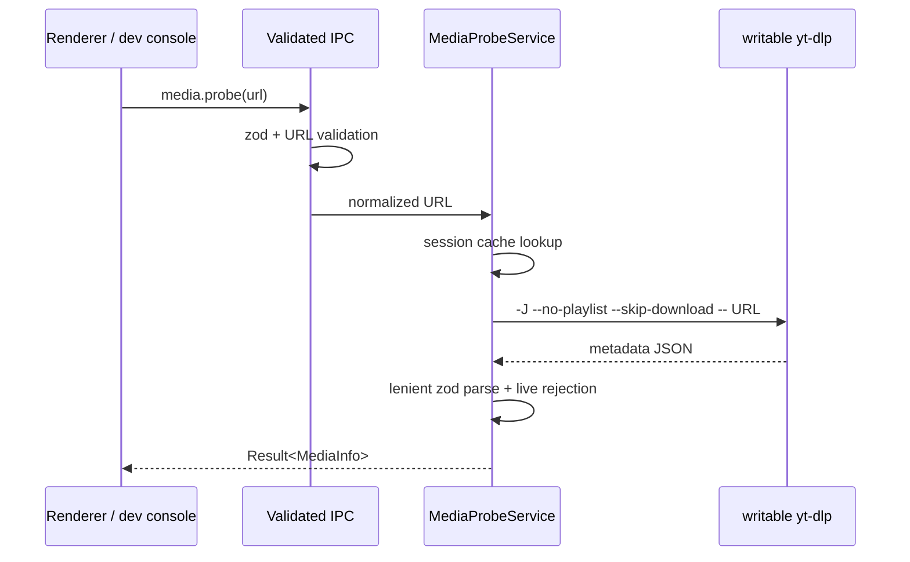
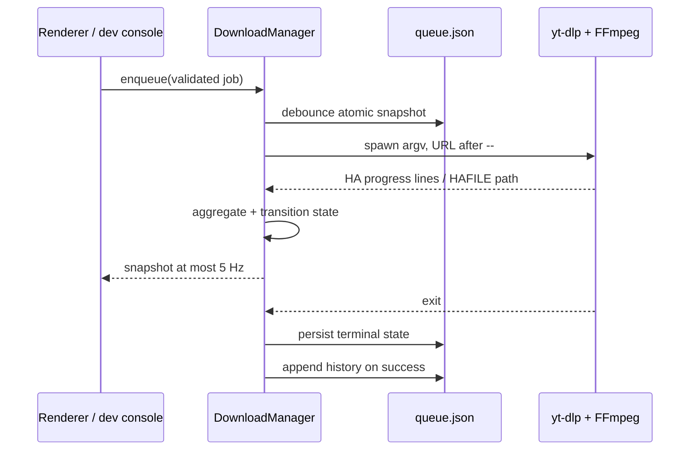

# Architecture

This document describes the Phase 2 application boundary. The download engine, queue, persistence, and operating-system services are real and fully available through validated IPC; Phase 3 will add their user-facing controls.

## Process model



The main process owns operating-system capabilities, application state, navigation policy, external links, and window lifecycle. The renderer has no Node.js access. Its only privileged surface is the typed API exposed by the context-isolated preload.

## Security boundary

- `contextIsolation`, Chromium sandboxing, and web security are enabled.
- Node integration and insecure mixed content are disabled.
- The preload exposes explicit methods rather than raw `ipcRenderer`.
- Every IPC payload is parsed with zod, including methods with no payload.
- Handlers return `Result<T, AppError>` and keep technical details out of UI copy.
- Navigation and new-window creation are blocked. Approved external destinations pass through a main-process allowlist.
- Production responses receive a strict CSP; the development policy adds only the local Vite/HMR connections.
- Logs stay local and redact query strings from URLs.

## Module map

```text
src/main/index.ts                 application lifecycle and single-instance lock
src/main/window/                  BrowserWindow creation, fade, and persisted bounds
src/main/security/                CSP, navigation guards, external URL policy
src/main/ipc/                     validated system, engine, queue, and service handlers
src/main/engine/                  binary install/update, ProcessRunner, yt-dlp adapters
src/main/downloads/               pure state machine and concurrent manager
src/main/services/                JSON stores, disk, files, clipboard, notifications
src/main/menu.ts                  native application menus
src/main/logger.ts                redacted local logging

src/preload/index.ts              narrow contextBridge implementation
src/preload/index.d.ts            renderer global API declaration

src/renderer/src/components/ui/   reusable accessible primitives
src/renderer/src/components/shell title bar, tabs, controls, boundaries
src/renderer/src/features/        lazy tab screens and dev-only UI kit
src/renderer/src/lib/copy.ts       renderer-visible English
src/renderer/src/styles/index.css semantic tokens and global styles

src/shared/ipc/                   channel names, API types, zod schemas
src/shared/types/                 dependency-free result and error types
src/shared/utils/                 pure formatting and URL helpers
```

`shared/` imports nothing from the other processes. The renderer never imports from `main/`, and the preload does not export a generic invoke function.

## Launch sequence



The sandboxed preload is intentionally emitted as CommonJS (`index.cjs`). Electron executes sandboxed preloads with its restricted CommonJS environment; emitting ESM would leave the bridge unavailable.

## Engine ownership

The main process is the sole owner of yt-dlp, FFmpeg, settings, queue state,
history, filesystem access, notifications, and badges. On first launch it copies
yt-dlp to `userData/engine`, makes it executable, and removes macOS quarantine
best-effort. FFmpeg stays in app resources. Only the writable yt-dlp copy can
self-update; a broken update is replaced by the bundled copy.

`ProcessRunner` always uses argument arrays, `shell: false`, and
`windowsHide: true`. macOS processes start in a dedicated process group so
SIGTERM/SIGKILL reaches FFmpeg descendants. Windows uses hidden
`taskkill /pid … /T /F`. URLs are placed after `--`, and logs redact query
strings.

## IPC contract

| Channel                   | Direction       | Input         | Result                              |
| ------------------------- | --------------- | ------------- | ----------------------------------- |
| `system:get-version`      | renderer → main | `undefined`   | app version                         |
| `system:open-external`    | renderer → main | `{ url }`     | success or allowlist error          |
| `window:minimize`         | renderer → main | `undefined`   | success                             |
| `window:toggle-maximize`  | renderer → main | `undefined`   | maximized state                     |
| `window:is-maximized`     | renderer → main | `undefined`   | maximized state                     |
| `window:close`            | renderer → main | `undefined`   | success before close                |
| `window:maximize-changed` | main → renderer | boolean event | unsubscribe function in preload API |

Phase 2 adds domain methods under `window.api.engine`, `media`, `downloads`,
`library`, `settings`, `dialog`, `shell`, and `clipboard`. Every request has a
zod schema and every response is `Result<T, AppError>`. The only pushed events
are engine status, batched download snapshots, library changes, settings
changes, and maximize state. `window.__ha` is exposed only by development
preloads and delegates to the same validated API.

## Probe sequence



## Download and progress sequence



## Pause and recovery sequence

```mermaid
sequenceDiagram
  participant UI as Renderer / dev console
  participant Manager as DownloadManager
  participant Process as Process group
  participant Store as queue.json
  UI->>Manager: pause(jobId)
  Manager->>Process: SIGTERM group / taskkill tree
  Process-->>Manager: exited; .part retained
  Manager->>Store: state = paused
  Note over Manager,Store: On relaunch, active jobs recover as paused and all recoverable jobs are held
  UI->>Manager: resume(jobId)
  Manager->>Process: spawn same template with --continue
```

## Persistence and recovery

`settings.json`, `queue.json`, and `history.json` are schema-versioned and
zod-validated. Writes use a temporary file, file `fsync`, rename, and directory
`fsync`. Invalid JSON is renamed with a `.corrupt-<timestamp>` suffix and safe
defaults are recreated. Queue writes debounce at 500 ms and settings at 300 ms.
An interrupted active job becomes paused at launch; queued and paused recovery
jobs do not start until explicitly resumed. History is newest-first and capped
at 5,000 entries.

## Renderer state and rendering

The shell owns only active-tab, visited-tab, and dev UI-kit state. Screens load through `React.lazy`; once visited they remain mounted and are hidden when inactive so future scroll and form state can survive tab changes. Shared copy and semantic styling keep later features consistent.

Zustand remains reserved for the Phase 3 renderer mirrors. Phase 2 intentionally leaves the visual status pill unchanged while the real status is available through IPC.

## Window state

Normal bounds and maximized state are stored as small JSON in Electron's `userData` directory. zod validates the file, off-screen bounds are rejected against connected displays, and writes use a temporary file followed by rename. Corrupt or unavailable state falls back to a centered 850×600 window.

## Packaging

electron-builder places application code in asar and copies owner-provided binaries into `Contents/Resources/binaries/macos`. The Phase 1 hook restores executable permissions and ad-hoc signs both binaries. Because the supplied FFmpeg is x86_64-only, the current macOS artifact is x64; native arm64 packaging waits for a matching FFmpeg input.
