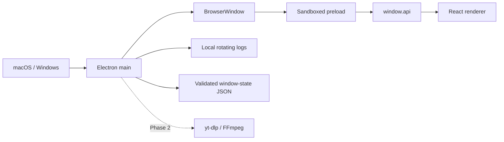
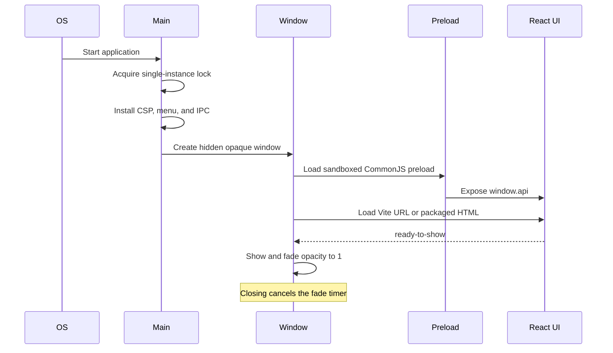

# Architecture

This document describes the Phase 1 application boundary. Download-engine and persistence flows will be added when Phase 2 implements them; no renderer mock stands in for those services today.

## Process model



The main process owns operating-system capabilities, application state, navigation policy, external links, and window lifecycle. The renderer has no Node.js access. Its only privileged surface is the typed API exposed by the context-isolated preload.

## Security boundary

- `contextIsolation`, Chromium sandboxing, and web security are enabled.
- Node integration and insecure mixed content are disabled.
- The preload exposes explicit methods rather than raw `ipcRenderer`.
- Every IPC payload is parsed with zod, including methods with no payload.
- Handlers return `Result<T, AppError>` and keep technical details out of UI copy.
- Navigation and new-window creation are blocked. Approved external destinations pass through a main-process allowlist.
- Production responses receive a strict CSP; the development policy adds only the local Vite/HMR connections.
- Logs stay local and redact query strings from URLs.

## Module map

```text
src/main/index.ts                 application lifecycle and single-instance lock
src/main/window/                  BrowserWindow creation, fade, and persisted bounds
src/main/security/                CSP, navigation guards, external URL policy
src/main/ipc/                     validated system and window handlers
src/main/menu.ts                  native application menus
src/main/logger.ts                redacted local logging

src/preload/index.ts              narrow contextBridge implementation
src/preload/index.d.ts            renderer global API declaration

src/renderer/src/components/ui/   reusable accessible primitives
src/renderer/src/components/shell title bar, tabs, controls, boundaries
src/renderer/src/features/        lazy tab screens and dev-only UI kit
src/renderer/src/lib/copy.ts       renderer-visible English
src/renderer/src/styles/index.css semantic tokens and global styles

src/shared/ipc/                   channel names, API types, zod schemas
src/shared/types/                 dependency-free result and error types
src/shared/utils/                 pure formatting and URL helpers
```

`shared/` imports nothing from the other processes. The renderer never imports from `main/`, and the preload does not export a generic invoke function.

## Launch sequence



The sandboxed preload is intentionally emitted as CommonJS (`index.cjs`). Electron executes sandboxed preloads with its restricted CommonJS environment; emitting ESM would leave the bridge unavailable.

## IPC contract

| Channel                   | Direction       | Input         | Result                              |
| ------------------------- | --------------- | ------------- | ----------------------------------- |
| `system:get-version`      | renderer → main | `undefined`   | app version                         |
| `system:open-external`    | renderer → main | `{ url }`     | success or allowlist error          |
| `window:minimize`         | renderer → main | `undefined`   | success                             |
| `window:toggle-maximize`  | renderer → main | `undefined`   | maximized state                     |
| `window:is-maximized`     | renderer → main | `undefined`   | maximized state                     |
| `window:close`            | renderer → main | `undefined`   | success before close                |
| `window:maximize-changed` | main → renderer | boolean event | unsubscribe function in preload API |

## Renderer state and rendering

The shell owns only active-tab, visited-tab, and dev UI-kit state. Screens load through `React.lazy`; once visited they remain mounted and are hidden when inactive so future scroll and form state can survive tab changes. Shared copy and semantic styling keep later features consistent.

Zustand is installed for Phase 2 feature slices but is not used to inflate Phase 1's local state. The Engine status pill truthfully reports setup pending until the real service exists.

## Window state

Normal bounds and maximized state are stored as small JSON in Electron's `userData` directory. zod validates the file, off-screen bounds are rejected against connected displays, and writes use a temporary file followed by rename. Corrupt or unavailable state falls back to a centered 850×600 window.

## Packaging

electron-builder places application code in asar and copies owner-provided binaries into `Contents/Resources/binaries/macos`. The Phase 1 hook restores executable permissions and ad-hoc signs both binaries. Because the supplied FFmpeg is x86_64-only, the current macOS artifact is x64; native arm64 packaging waits for a matching FFmpeg input.
