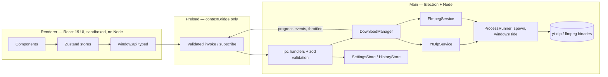

# HA Premium Video Downloader — MASTER PROMPT

> **Audience:** any AI coding agent (OpenAI Codex, Claude Code, or similar) working in this repository.
> **Owner:** Hussain Ahmed (`hussainislive`). **Status of this file:** the single source of truth for *what* to build and *how*. If anything here conflicts with a guess you would otherwise make, this file wins. If this file is silent or ambiguous, apply the rules in section 1.4 (decide, record, move on; ask only if blocked).

---

## 0. HOW TO USE THIS FILE (READ FIRST)

### 0.1 Execution protocol

The owner will give you short commands such as **"Execute Phase 2"**. When that happens:

1. Read, in this order: `CLAUDE.md` (or `AGENTS.md`), this file in full, `docs/PROGRESS.md`, `docs/DECISIONS.md`, then `design/DESIGN.md` and the `code.html` of every screen the phase touches.
2. Execute **only** the requested phase. Never start the next phase. Never skip a phase unless `docs/PROGRESS.md` shows it is already complete and verified.
3. Work in this loop for every task inside the phase (this is "loop engineering"):
   **PLAN → IMPLEMENT → VERIFY → DOCUMENT → REPORT.**
   - PLAN: write a short numbered task list (in your reply and in `docs/PROGRESS.md`) before touching code.
   - IMPLEMENT: smallest coherent change at a time; keep the app runnable after every step.
   - VERIFY: run the quality gates (section 12.1) after every meaningful step, not only at the end. Fix failures before continuing.
   - DOCUMENT: update docs as defined in section 14 at the end of the phase (and ADRs the moment you make a significant decision).
   - REPORT: finish with the phase report template in section 14.4.
4. A phase is complete **only** when every item in its "Definition of Done" is true and the full quality gates are green. Do not claim completion otherwise. If something cannot be completed, say exactly what and why in the report.
5. Commit locally on a branch named `phase-N-<slug>` using Conventional Commits (section 12.6). **Never push, force-push, rewrite history, or touch `main` unless the owner explicitly asks.** Never delete or overwrite the `design/` folder or the `binaries/` folder.

### 0.2 Session start checklist

At the start of every session: confirm the working directory is the repo root; run `git status`; read `docs/PROGRESS.md`; run `npm run typecheck` to learn the baseline; only then begin.

### 0.3 Command vocabulary the owner will use

| Owner says | You do |
|---|---|
| `Execute Phase N` | Run the full protocol above for phase N. |
| `Continue Phase N` | Read `docs/PROGRESS.md`, resume the unfinished tasks of phase N. |
| `Fix: <description>` | Reproduce, write a failing test first when feasible, fix, run gates, add a CHANGELOG line. |
| `Review Phase N` | Do not add features. Audit phase N against its Definition of Done and this file; list gaps; fix only real gaps. |
| `Status` | Summarize `docs/PROGRESS.md` and the git state. No code changes. |

---

## 1. PRODUCT DEFINITION

### 1.1 What we are building

**HA Premium Video Downloader** is a free, open-source, cross-platform desktop application (macOS Intel + Apple Silicon, Windows 10/11 x64) that gives `yt-dlp` and `ffmpeg` a polished, fast, beautiful GUI. The user pastes a link, sees a rich preview, chooses quality/format, and downloads. All command-line work happens silently in the background — **no terminal window may ever appear**, on any OS.

Design personality: **dark obsidian glassmorphism with emerald-green accents**; compact widget-style window; buttery 60 fps interactions; professional, calm, precise. Not a website, not a toy.

### 1.2 In scope (the full v1.0 feature list)

- Single-video and single-audio download from every site `yt-dlp` supports (YouTube, Facebook, Instagram, Vimeo, TikTok, X, Reddit, etc.).
- Live URL validation, clipboard paste/auto-paste, rich metadata preview (thumbnail, title, uploader, duration, platform badge, views/upload date when available).
- Video qualities **4K (2160p), 2K (1440p), 1080p, 720p, 480p** with **MP4 or MKV** container; audio extraction to **MP3, M4A, WAV** with **320/256/128 kbps** where applicable (WAV is lossless: bitrate control is disabled).
- Estimated file size before download.
- Background merge of best video + best audio via `ffmpeg`.
- Download queue with real-time progress (percent, speed, ETA, downloaded/total), **pause, resume, cancel, retry**, open folder, quick play.
- Concurrent downloads (configurable 1–4, default 2); queue persists across app restarts.
- Library/history: search, filter (All/Video/Audio), sort, open file location, play, delete from history (with optional "also delete file" confirmation).
- Settings: download folder (native folder picker, default `~/Downloads/HA-Downloader`), defaults for quality/format, behavior toggles shown on the Settings screen, engine status and one-click **Check & Update Engine**.
- About screen (developer profile, links, donate link, open-source message).
- Native-feeling window: custom frameless title bar, OS-correct window controls, drag region, min size 850×600, resizable and responsive.
- Desktop notifications on completion/failure, dock/taskbar badge for active downloads (where supported).
- Robust, friendly error handling for every failure class (section 8.9).

### 1.3 Out of scope for v1.0 (do NOT build; may appear in README roadmap)

Playlist/channel batch download (detect playlist URLs and download the single video only, with a gentle notice), subtitles download UI, cookie/login import, scheduled downloads, built-in video player, browser extension, auto-update of the app itself, telemetry/analytics of any kind (the app must make **zero** network calls other than to the media sites the user asks for, and to GitHub when the user clicks "Check & Update Engine"), Linux packaging (keep code portable, but do not test or package it).

### 1.4 Decision rule for gaps

When a detail is missing: (a) choose the option most consistent with this file and the design; (b) record it in `docs/DECISIONS.md` as a one-paragraph ADR; (c) continue. Ask the owner **only** if the choice is irreversible, costs money, changes the visible design, or is a legal/licensing decision. Never invent features that are not listed in this file or visible in a screen's `code.html`.

### 1.5 Legal and ethics posture

The app is a neutral tool. The README and the About screen footer must state: *"Download only content you have the right to download. You are responsible for complying with the terms of the sites you use and with local copyright law."* Ship `THIRD_PARTY_NOTICES.md` covering yt-dlp, ffmpeg (note the license of the **specific ffmpeg build** shipped — check `ffmpeg -version` / `-L` output), Electron, React and every runtime dependency. This is not legal advice; flag license questions to the owner.

---

## 2. SOURCE-OF-TRUTH HIERARCHY AND DESIGN AUDIT

When sources disagree, the higher one wins:

1. **Owner's latest instruction** in the current session.
2. **This file** (`master-prompt.md`).
3. **`design/<screen>-screen/code.html`** — layout, spacing, copy, states, and visual details for that screen.
4. **`design/DESIGN.md`** — design tokens, component rules, elevation, typography, motion. Its *layout* section (960×640 baseline, 240px side rail, left traffic lights as the only chrome) is **superseded** by the screens: the real layout is a top title bar + top pill tabs, min window 850×600.
5. `design/**/screen.png` — only one exists; the rest were corrupt and removed. Treat PNGs as secondary to HTML.

### 2.1 Known issues in the Stitch HTML (fix when porting, never copy blindly)

- It loads **Tailwind via CDN** and **Google Fonts via CDN** → the app must bundle Tailwind v4 and local fonts (`@fontsource-variable/*`) and work **fully offline**.
- Colors are **hard-coded hex values** repeated everywhere → replace with the semantic design tokens in section 6.2 (this is how the owner will re-theme later).
- The About screen photo is a **temporary remote URL** → use the local asset `src/renderer/src/assets/developer.jpg` (the owner supplies it; if missing, render a tasteful initials avatar "HA" fallback and list it in the phase report).
- The artboard is a **fixed 850×600 box with a 24px outer radius**. Real windows are resizable (min 850×600) and the OS owns window corner rounding → the app root fills the window with **no outer radius and no outer border**. Card radii inside stay as designed.
- LinkedIn link must be exactly `https://www.linkedin.com/in/hussainislive/` (not the shortened HTML form).
- Some screens may contain **invented capabilities** (hardware encoders, ProRes, "parser daemon", fake version badges, bandwidth tickers). Audit every `code.html`; remove or neutralize anything the app cannot truthfully do, and list removals in `docs/DESIGN-AUDIT.md`.
- Static demo data (sample titles, sizes, percentages) is placeholder only.

### 2.2 Fidelity protocol (applies to every screen)

For each screen: (1) render the original `code.html` at 850×600 with Playwright into `design/_renders/<screen>.png` via `scripts/render-design.ts` (needs internet once, because the HTML uses CDNs; commit the PNGs); (2) build the React version; (3) compare against the render at 850×600 and at larger sizes; (4) fix deltas in spacing, radius, font size/weight, color, icon size, and hover/focus states. Pixel-perfect at 850×600 with mock data is the target; deviations must be deliberate and documented.

---

## 3. TECH STACK AND VERSION POLICY

### 3.1 Version policy (important)

Do **not** trust version numbers written from memory, including the ones below. At the start of Phase 1 run `npm view <package> version` (and `npm view <package> peerDependencies` for build tooling) for every dependency, then:

- Pick the **latest stable** release. Never use `alpha`, `beta`, `rc`, `canary`, or `next` tags.
- Prefer a release that is **at least 14 days old** (avoid freshly published versions).
- For build tooling, **respect peer-dependency ranges** (e.g. the Vite version must satisfy `electron-vite`'s peer range; TypeScript must be supported by `typescript-eslint`). Compatibility beats "newest".
- **Pin exact versions** in `package.json` (no `^`/`~`) and commit the lockfile. Record the resolved table in `docs/STACK.md` with the date.
- Renovate/Dependabot-style upgrades are out of scope; upgrades happen only on owner request or for a security advisory (`npm audit` high/critical must be zero at the end of Phase 5).

### 3.2 Baseline expectations (as of 2026-10-09; verify, then record the real versions)

| Area | Choice | Notes |
|---|---|---|
| Runtime for tooling | **Node.js 24 LTS** | Matches the Node major bundled with current Electron. Add `.nvmrc` and `engines`. |
| Package manager | **npm** | Chosen for lowest friction with `electron-builder`. Do not mix managers. |
| Desktop shell | **Electron — latest stable major (44.x on 2026-10-09)** | Electron 45 is scheduled to go stable on 2026-10-20: do **not** adopt a brand-new major until it has had a few patch releases, unless the owner asks. Always the latest *patch* of the chosen major (security). |
| Build system | **electron-vite** + **Vite** | Scaffold with the official `react-ts` template; keep the `main` / `preload` / `renderer` layout. |
| Language | **TypeScript, `strict: true`** | Plus `noUncheckedIndexedAccess`, `exactOptionalPropertyTypes`, `noImplicitOverride`, `noFallthroughCasesInSwitch`, `verbatimModuleSyntax`. No `any` (lint-enforced); use `unknown` + narrowing. |
| UI | **React 19** | Function components + hooks only. |
| Styling | **Tailwind CSS v4** via `@tailwindcss/vite` | Tokens defined in CSS with `@theme` (section 6.2). No `tailwind.config.js` colors, no hard-coded hex in components. |
| Animation | **Motion** (the library formerly named Framer Motion; package `motion`, import from `motion/react`; if the owner insists on the old package name, `framer-motion` is acceptable) | |
| Icons | **lucide-react** | 1.5px stroke to match the design (`strokeWidth={1.5}`), sizes from tokens. |
| State | **Zustand** (v5 line) | Slice pattern; selector-based subscriptions only. |
| Validation | **zod** | All IPC payloads and persisted JSON are validated at the boundary. |
| Process execution | **`node:child_process.spawn`** wrapped by our own `ProcessRunner` | Deliberate deviation from the brief's `execa`: execa is ESM-only and complicates the CJS main bundle; `spawn` gives exact control of streaming, `windowsHide`, and process-tree termination. Record as an ADR. |
| Logging | **electron-log** | File logs in the OS log dir, redaction of URLs' query strings in logs by default. |
| Virtual lists | **@tanstack/react-virtual** | Library list when > 50 rows. |
| Fonts | `@fontsource-variable/plus-jakarta-sans`, `@fontsource-variable/inter` | Bundled, no CDN. |
| Unit/component tests | **Vitest** + **@testing-library/react** + **jsdom** (or happy-dom) | |
| E2E tests | **Playwright** (`@playwright/test`) using its **Electron** support (`_electron.launch`) | Also used for visual regression and accessibility (`@axe-core/playwright`). |
| Lint/format | **ESLint (flat config)** + `typescript-eslint` + `eslint-plugin-react-hooks` + `eslint-plugin-jsx-a11y` + `eslint-plugin-import`/`simple-import-sort`; **Prettier** + `prettier-plugin-tailwindcss` | |
| Packaging | **electron-builder** | macOS: DMG (x64 + arm64), Windows: NSIS installer (x64). Unsigned for now. |
| Git hooks | **husky** + **lint-staged** (typecheck on pre-push is optional) | Keep hooks fast (< 10 s). |

### 3.3 Required npm scripts (create in Phase 1, keep names stable)

```
dev              electron-vite dev (HMR)
build            typecheck + electron-vite build
preview          electron-vite preview
typecheck        tsc --noEmit for node + web projects
lint             eslint . --max-warnings 0
format           prettier --write .
format:check     prettier --check .
test             vitest run
test:watch       vitest
test:coverage    vitest run --coverage
test:e2e         build, then playwright test (fake engine, deterministic)
test:e2e:live    playwright test --grep @live (real yt-dlp, needs internet; opt-in)
verify:binaries  tsx scripts/verify-binaries.ts
render:design    tsx scripts/render-design.ts
dist:mac         build + electron-builder --mac
dist:win         build + electron-builder --win
check            typecheck && lint && format:check && test && test:e2e   <- THE QUALITY GATE
```

---

## 4. REPOSITORY STRUCTURE (TypeScript adaptation of the owner's blueprint)

The owner's blueprint (`binaries/`, `src/main`, `src/preload`, `src/renderer`, `electron-builder.yml`) is preserved; `.js` becomes `.ts/.tsx`, and a `src/shared` folder is added for code used by more than one process.

```text
ha-video-downloader/                       (git repo: HA-VideoDownloader)
├── AGENTS.md                              agent rules (Codex and others)
├── CLAUDE.md                              agent rules (Claude Code)
├── master-prompt.md                       this file
├── README.md                              human-written project README (updated every phase)
├── CHANGELOG.md                           Keep-a-Changelog format
├── LICENSE                                MIT unless the owner says otherwise (flag in Phase 1 report)
├── THIRD_PARTY_NOTICES.md
├── CONTRIBUTING.md                        (Phase 5)
├── package.json  package-lock.json  .nvmrc  .editorconfig  .gitignore  .prettierrc  eslint.config.mjs
├── electron.vite.config.ts                electron-vite config (aliases, Tailwind plugin)
├── electron-builder.yml                   packaging (section 13)
├── tsconfig.json  tsconfig.node.json  tsconfig.web.json
├── vitest.config.ts   playwright.config.ts
├── binaries/                              OWNER-PROVIDED, NOT COMMITTED (see 4.2)
│   ├── README.md                          where each binary comes from + how to verify
│   ├── macos/   (yt-dlp, ffmpeg)          or macos-arm64/ + macos-x64/ if ffmpeg is not universal
│   └── win/     (yt-dlp.exe, ffmpeg.exe)
├── design/                                OWNER-PROVIDED, READ-ONLY for agents
│   ├── DESIGN.md
│   ├── about-screen/  downloader-screen/  library-screen/  queue-screen/  settings-screen/   (code.html each)
│   └── _renders/                          PNG renders of each code.html (generated by scripts/render-design.ts)
├── docs/
│   ├── PROGRESS.md                        live phase/task tracker (agents update every session)
│   ├── ARCHITECTURE.md                    process model, data flow diagrams (mermaid), module map
│   ├── DECISIONS.md                       ADR log
│   ├── DESIGN-AUDIT.md                    findings from section 2.1
│   ├── STACK.md                           resolved dependency versions + dates
│   ├── TESTING.md                         how to run tests, fake engine, live tests
│   └── QA-CHECKLIST.md                    manual release checklist (macOS Intel/ARM, Windows)
├── resources/
│   ├── icon.png                           1024×1024 app icon (derive from the logo glyph on emerald/obsidian)
│   └── installer/                         dmg background etc. (optional)
├── scripts/
│   ├── verify-binaries.ts                 presence, +x, architecture (lipo/file), --version, codesign state
│   ├── render-design.ts                   renders design/*/code.html → design/_renders/*.png
│   └── dev-utils/…
├── src/
│   ├── shared/                            pure TS, no Node/DOM APIs
│   │   ├── ipc/                           channel names (const map), request/response/event types, zod schemas
│   │   ├── types/                         DownloadJob, MediaInfo, Settings, HistoryItem, EngineStatus, AppError…
│   │   └── utils/                         formatBytes, formatDuration, formatSpeed, url helpers (pure, unit-tested)
│   ├── main/                              Electron main process
│   │   ├── index.ts                       app lifecycle only (≤ 80 lines): single instance, ready, window, quit
│   │   ├── window/                        createMainWindow, platform chrome options, window-state persistence, controls IPC
│   │   ├── ipc/                           registerIpc(), one file per domain (downloads, settings, library, engine, system)
│   │   ├── engine/                        binaries.ts (resolve/install), process-runner.ts, ytdlp/ (args, parse, errors, formats), ffmpeg.ts, updater.ts
│   │   ├── downloads/                     download-manager.ts (queue/state machine), job.ts, persistence.ts, filename.ts
│   │   ├── services/                      settings-store.ts, history-store.ts, notifications.ts, disk.ts, clipboard.ts, shell.ts
│   │   ├── security/                      navigation guards, CSP, URL allowlist for shell.openExternal
│   │   ├── menu.ts                        native application menu (macOS standard menu incl. Edit; minimal on Windows)
│   │   └── logger.ts
│   ├── preload/
│   │   ├── index.ts                       contextBridge.exposeInMainWorld('api', …) — the ONLY bridge
│   │   └── index.d.ts                     window.api typing
│   └── renderer/
│       ├── index.html                     strict CSP meta; no external origins
│       └── src/
│           ├── main.tsx   App.tsx
│           ├── assets/                    developer.jpg, logo.svg, fonts import
│           ├── styles/                    index.css (@import "tailwindcss"; @theme tokens; @layer components/utilities)
│           ├── components/
│           │   ├── ui/                    primitives: Button, IconButton, Card, Badge/Pill, Input, Select, SegmentedControl,
│           │   │                          Switch, ProgressBar, Tooltip, Toast, EmptyState, Spinner, ConfirmDialog, Kbd
│           │   ├── shell/                 TitleBar, WindowControls, TabBar, EngineStatusPill, AppShell
│           │   └── common/                ErrorBoundary, PlatformBadge, Thumbnail
│           ├── features/
│           │   ├── downloader/            UrlInputCard, MediaPreviewCard, OptionsCard, SaveLocationRow, DownloadCta, hooks, store slice
│           │   ├── queue/                 QueueList, DownloadCard (state variants), hooks, slice
│           │   ├── library/               SearchBar, FilterPills, HistoryRow, hooks, slice
│           │   ├── settings/              LocationCard, EngineCard, PreferencesCard, AboutCard
│           │   └── about/                 ProfileCard, AboutMeCard, ExpertiseCard, OpenSourceCard, ConnectRow
│           ├── store/                     zustand slices + selectors (downloads, settings, ui, library)
│           ├── hooks/                     useIpcEvent, useClipboardUrl, useHotkeys, usePlatform, useReducedMotion
│           ├── lib/                       cn(), motion presets, formatters re-exports, platform helpers
│           └── dev/                       UiKitPage (dev-only route listing every primitive in every state)
└── tests/
    ├── unit/                              mirrors src/ (vitest)
    ├── e2e/                               playwright electron specs + fixtures
    │   ├── fixtures/fake-engine/          deterministic yt-dlp/ffmpeg stand-ins (see section 11.3)
    │   └── visual/                        screenshot baselines
    └── fixtures/ytdlp/                    captured real outputs (JSON metadata, progress lines, error stderr) for parser tests
```

### 4.1 Structure rules

- **One responsibility per file; target ≤ 250 lines, hard cap 400.** Split before the cap, not after.
- Feature code lives in `features/<name>`; anything used by ≥ 2 features moves to `components/ui` or `lib`.
- `shared/` imports nothing from `main/`, `preload/` or `renderer/`.
- The renderer **never** imports from `main/`. The main process **never** imports from `renderer/`.
- Barrel files (`index.ts`) only at feature boundaries; do not create deep barrel chains.
- Path aliases: `@shared/*`, `@main/*`, `@renderer/*` (configured in tsconfig + electron-vite + vitest).

### 4.2 Binaries are not committed

`ffmpeg` builds are tens of MB (GitHub rejects files ≥ 100 MB, and bloats history forever), and redistributing GPL-licensed ffmpeg builds has obligations. Therefore:

- Add `binaries/macos*/`, `binaries/win/` contents to `.gitignore` but **keep** `binaries/README.md` tracked (documents official sources, versions, and SHA-256 verification).
- `npm run verify:binaries` must pass before `dev`, `test:e2e`, and `dist:*` (wire as a `pre` script). It checks: files exist, executable bit (macOS), `--version` output for both tools, the architecture(s) of each macOS binary (`lipo -info` / `file`), ad-hoc/linker signature presence on arm64 (`codesign -dv`), and that no Windows `.exe` is a placeholder.
- Release builds copy binaries from `binaries/` into the package via `extraResources` (section 13). Never put them inside the asar.

---

## 5. ARCHITECTURE

### 5.1 Process model



### 5.2 Security baseline (non-negotiable)

- `BrowserWindow` options: `contextIsolation: true`, `nodeIntegration: false`, `sandbox: true`, `webSecurity: true`, `allowRunningInsecureContent: false`, `spellcheck: false`. No `remote` module. No `enableBlinkFeatures`.
- Renderer loads only the bundled app. A strict **CSP** (meta tag in `index.html` plus response headers set via `session.webRequest` in production): `default-src 'self'; script-src 'self'; style-src 'self' 'unsafe-inline'; img-src 'self' data: https: ; font-src 'self'; connect-src 'self'; object-src 'none'; base-uri 'none'; frame-ancestors 'none'`. (`img-src https:` is needed for remote thumbnails; fetch thumbnails through the main process into a small on-disk cache if you can do so without hurting responsiveness — recorded as an ADR either way. In dev, Vite HMR needs relaxed `connect-src`/`script-src`; relax **only** when `is.dev`.)
- Block all navigation and new windows: `webContents.setWindowOpenHandler(() => ({ action: 'deny' }))`, handle `will-navigate` by preventing it. External links go through the `system:openExternal` IPC, which allows **only** `https:` URLs on an explicit allowlist (github.com, linkedin.com, paypal.me, the yt-dlp release page) plus `mailto:` for the developer address.
- **IPC contract:** channel names are constants in `src/shared/ipc`. The preload exposes narrow, purpose-named functions (`downloads.start(...)`, never a generic `invoke(channel, ...)`). Every handler validates input with zod and returns a typed `Result<T, AppError>`; handlers never throw raw errors to the renderer.
- **Never** build shell command strings. Spawn with an **argument array**, `shell: false`. User-supplied URLs are passed as a single argument after `--` so they can never be parsed as flags. Validate that the output folder exists/is writable and is not a protected system path.
- Filenames come from yt-dlp's `-o` template with `%(title).200B` truncation and `--windows-filenames` to stay safe on both OSes.
- Persisted JSON is zod-validated on load; corrupt files are quarantined (`*.corrupt-<timestamp>`) and defaults restored, with a user-visible toast, never a crash.
- Single instance lock (`app.requestSingleInstanceLock`); a second launch focuses the existing window.
- No analytics, no crash reporters that phone home, no remote code, no `eval`.

### 5.3 State and data flow

- The **main process owns truth** for downloads, settings, and history. The renderer holds a read-optimized mirror in Zustand, hydrated once via `getSnapshot()` and updated via typed events (`downloads:updated`, `downloads:removed`, `settings:changed`, `engine:status`).
- Progress events are **coalesced and throttled in main to ≤ 5 per second per job** (and batched into one IPC message per tick for all jobs). The renderer must not re-render the whole list on every tick: per-job selectors with shallow equality, `React.memo` on cards, progress bar width animated via `transform: scaleX` (not layout properties).
- Optimistic UI only for pure UI state (tab, dropdowns). Anything that mutates downloads waits for the main-process acknowledgement or event.

### 5.4 Error model

`AppError = { code: ErrorCode; message: string /* user-facing, plain English */; detail?: string /* technical, log-only */; retryable: boolean; hint?: 'update-engine' | 'check-network' | 'free-space' | 'change-folder' }`. Codes are enumerated in `src/shared/types/errors.ts`. The UI maps `code` to copy and a recovery action; raw stderr is **never** shown to the user (it is logged).

---

## 6. DESIGN SYSTEM (implement in Phase 1, reuse everywhere)

### 6.1 Principles

Compact, calm, precise. Every element sits on an 8px grid (4px increments allowed inside components). One primary action per screen. Glass only where it earns its cost (section 12.3). Never decorate with random gradients; glow means "active/primary".

### 6.2 Design tokens — the ONE place colors live

Implement in `src/renderer/src/styles/index.css` using Tailwind v4 `@theme`. **Components use semantic utilities only** (`bg-surface`, `text-fg-muted`, `border-line`, `text-accent`…). Raw hex or `rgba()` in components/JSX is a lint-level violation; the only file that may contain hex is `styles/index.css`. Re-theming later = editing this block.

```css
@import "tailwindcss";
@import "@fontsource-variable/plus-jakarta-sans";
@import "@fontsource-variable/inter";

@theme {
  /* canvas */
  --color-canvas-from: #090d0a;
  --color-canvas-to:   #0d120e;
  /* surfaces */
  --color-surface:          rgb(20 28 22 / 0.62);   /* glass card */
  --color-surface-solid:    #141c16;                /* non-blurred fallback / list rows */
  --color-surface-elevated: #1c261f;                /* inputs, dropdown triggers, chips */
  --color-surface-overlay:  rgb(24 34 27 / 0.92);   /* menus, modals */
  /* accent */
  --color-accent:        #0fd920;                   /* primary */
  --color-accent-hover:  #0bb81b;
  --color-accent-glow:   #13fe27;                   /* highlights only */
  --color-accent-soft:   rgb(15 217 32 / 0.10);     /* tinted fills, active badges */
  --color-accent-on:     #090d0a;                   /* text on accent */
  /* lines */
  --color-line:        rgb(15 217 32 / 0.15);       /* card borders */
  --color-line-strong: rgb(15 217 32 / 0.30);       /* hover/focus borders */
  --color-line-subtle: rgb(15 217 32 / 0.08);       /* dividers */
  /* text */
  --color-fg-heading: #f0fdf4;
  --color-fg-body:    #dcfce7;
  --color-fg-muted:   #718e76;
  /* status */
  --color-danger:  #ff5d6c;   --color-danger-soft:  rgb(255 93 108 / 0.12);
  --color-warning: #ffbd2e;   --color-warning-soft: rgb(255 189 46 / 0.12);
  --color-info:    #5cc8ff;   --color-info-soft:    rgb(92 200 255 / 0.12);
  /* radii */
  --radius-sm: 0.25rem; --radius-md: 0.5rem; --radius-lg: 0.75rem; --radius-xl: 1rem; --radius-2xl: 1.25rem; --radius-3xl: 1.5rem;
  /* type */
  --font-sans: "Plus Jakarta Sans Variable", "Plus Jakarta Sans", system-ui, sans-serif;
  --font-ui:   "Inter Variable", "Inter", system-ui, sans-serif;     /* telemetry, numbers, labels */
  /* elevation */
  --shadow-card:  0 8px 32px 0 rgb(0 0 0 / 0.45), inset 0 1px 0 0 rgb(255 255 255 / 0.05);
  --shadow-glow-sm: 0 0 16px rgb(15 217 32 / 0.28);
  --shadow-glow-cta: 0 0 24px -4px rgb(19 254 39 / 0.45), inset 0 1px 0 rgb(255 255 255 / 0.30);
  --shadow-focus: 0 0 0 2px rgb(15 217 32 / 0.20), 0 0 16px rgb(19 254 39 / 0.25);
  /* motion */
  --ease-out-expo: cubic-bezier(0.16, 1, 0.3, 1);
  --ease-standard: cubic-bezier(0.2, 0, 0, 1);
  --duration-fast: 120ms; --duration-base: 180ms; --duration-slow: 280ms;
}
```

Rules: (a) the exact hex/alpha values above come from `DESIGN.md` and the screens — if the owner's screens use a slightly different literal (e.g. card alpha 0.62 vs 0.60), follow the **screens**, update the token once, and note it in `docs/DESIGN-AUDIT.md`; (b) add dark-only for now but keep tokens semantic so a light theme is possible later; (c) expose a `data-theme` attribute on `<html>` and write the tokens under `:root` so alternate palettes can override them.

### 6.3 Typography

Plus Jakarta Sans for headings/body; Inter for telemetry (speeds, sizes, bitrates, timestamps) with `font-variant-numeric: tabular-nums`. Scale from the screens: title bar 13px/600; tab 12px/500; card section title 12px/700 uppercase tracking-wider; body 12.5–13px; caption 11px; badges 11px/500; page headline 20px/700. Minimum text size 11px (10px only for uppercase micro-labels). Fonts are bundled; no network.

### 6.4 Core primitives (build in Phase 1 under `components/ui`, each documented in the dev UI-kit page with every state)

`Button` (primary pill glowing / secondary ghost / danger / icon), `IconButton` (40px round glass, 28px compact), `Card` (glass, radius per screen = `rounded-[20px]` → map to a token), `Badge/Pill` (accent / neutral / status), `Input` (48px hero + 36px compact; focus ring from `--shadow-focus`), `Select` (custom accessible listbox, Level-3 menu, keyboard navigable; never the native `<select>` popup because it ignores the theme), `SegmentedControl` (sliding indicator via `layoutId`), `Switch` (36×20), `Checkbox`, `ProgressBar` (4–6px, `scaleX` fill, glowing head, indeterminate shimmer variant), `Tooltip`, `Toast` (stack bottom-right inside the window, auto-dismiss, `role="status"`), `EmptyState`, `Spinner`, `ConfirmDialog` (focus-trapped modal), `Kbd`.

Interaction states, always all of them: default, hover (border to `line-strong`, text brightens, optional glow), focus-visible (accent ring — never remove outlines without replacement), active/pressed (`scale-[0.98]`), disabled (opacity .45, `cursor-not-allowed`), loading (spinner, width stable — no layout shift).

### 6.5 Motion spec (buttery, but purposeful)

- Use **transform and opacity only** for animation. Never animate `width/height/top/left/box-shadow blur radius/backdrop-filter`.
- Tab change: outgoing fades/slides 6px over `--duration-fast`, incoming over `--duration-base` with `--ease-out-expo`; the active-tab pill uses a shared `layoutId` so it glides between tabs. Screens are mounted lazily (`React.lazy` + `Suspense` with a skeleton that matches layout) and kept mounted after first visit to preserve scroll/state; hidden screens use `content-visibility: hidden` / `display:none` so they cost nothing.
- Cards mount with a 6–8px rise + fade, staggered 30–40 ms (max 6 children). List insert/remove uses `AnimatePresence` + `layout="position"`.
- Buttons: hover lift/brightness within `--duration-fast`; CTA hover increases glow, press scales to 0.98. Engine status dot pulses slowly (2s, opacity only).
- Progress fill transitions are **linear 200 ms** to hide the 5 Hz update cadence.
- Respect `prefers-reduced-motion`: replace movement with opacity-only 80 ms fades; disable pulses and shimmer.
- Frame budget: no jank at 60 fps on a 2020 MacBook Air; verify with the Chromium performance panel in Phase 5.

### 6.6 Window shell and OS-native behavior

Set `<html data-platform="darwin|win32">` from the preload-provided platform string; platform differences are handled in CSS variables and a few conditional components, not scattered `if`s.

| Concern | macOS | Windows |
|---|---|---|
| Frame | `titleBarStyle: 'hidden'`, **native traffic lights** at the left (`trafficLightPosition: { x: 14, y: 14 }` — tune so the 12px lights are vertically centered in the 44px bar) | `titleBarStyle: 'hidden'` (frameless chrome, native resize borders and Snap Layouts preserved; prefer `titleBarOverlay` only if it can match the design — otherwise custom controls) |
| Controls | Native lights; the HTML min/close buttons from the design are **not rendered**. Reserve a left inset (`--titlebar-inset-left: 78px`) so the logo/title start after the lights. Maximize (green) = zoom/fullscreen per OS convention. | Custom **minimize / maximize-restore / close** buttons at the right (the design shows min/close; maximize-restore is added because the window is resizable). Same 28px glass style; close hovers danger red. Icons swap on maximize state. |
| Corners/shadow | OS draws rounded corners + shadow. **Do not** use `transparent: true` windows. | Win 11 rounds natively; Win 10 square. Do not fake rounding with transparency (breaks resize/snap). |
| Drag | Title bar is `-webkit-app-region: drag`; every interactive child (`status pill`, controls, buttons) is `no-drag`. Double-click on the bar toggles maximize/zoom. | Same. |
| Size | `minWidth: 850, minHeight: 600`, default 850×600 (center on first run), remember size/position/maximized state between runs (validate it is still on a connected display). | Same. |
| Show | `show: false` then `ready-to-show` → fade-in (avoids white flash); `backgroundColor` = `--color-canvas-from`. | Same. |
| Menu | Full standard macOS app menu (App, Edit with undo/redo/cut/copy/paste/select all — **required** or paste into inputs breaks —, View with reload/devtools only in dev, Window, Help). | Hide the menu bar (`autoHideMenuBar`/`Menu.setApplicationMenu(null)`) but keep accelerators for copy/paste working. |
| Close | Closing the window quits the app (this is a single-window utility). If downloads are active, show a native `dialog.showMessageBox` confirm; on confirm, active jobs are persisted as **paused** and offered for resume on next launch. | Same. |
| Extras | Dock badge = active/queued count; dock-bounce on completion if window unfocused. | Taskbar progress via `win.setProgressBar` (aggregate), overlay not needed. |

### 6.7 Responsiveness rules

- **Floor:** 850×600. Below that the OS prevents shrinking (min size). **Ceiling:** layouts must look intentional up to 1920×1080 and on ultrawide windows.
- Content area = `flex-1 min-h-0 overflow-y-auto` with 20px padding; **no horizontal scroll ever**; custom thin scrollbar (6px, `fg-muted` thumb at 40% alpha) styled via tokens.
- Breakpoints by **container width** (use Tailwind v4 container queries `@container` on the content area, not viewport): base 850–1023, `md` ≥ 1024, `lg` ≥ 1280. At base, layouts match the screens exactly. At `md`/`lg`: Downloader preview + options become a two-column split; Library rows gain extra metadata columns; About keeps its two-column layout with the profile card growing to 340px; cards cap at `max-w-[1200px]` and the content centers.
- Height: at 600px the Downloader screen must fit **without** scrolling (as in the design). Extra height is distributed (preview card grows, then spacing), never left as a dead gap. Verify at 850×600, 1024×700, 1280×800, 1920×1080, and with OS display scaling 100/125/150/200%.
- Text never truncates without an ellipsis + `title`/tooltip; numbers never wrap.

### 6.8 Accessibility floor

Keyboard reachable everything (logical tab order, visible focus), `aria-*` on custom controls (listbox, tablist/tab/tabpanel for the nav, `role="progressbar"` with `aria-valuenow`), color contrast ≥ WCAG AA for text (muted text `#718e76` on canvas passes — keep it that way if re-themed), `aria-live="polite"` for toasts/status, icon-only buttons have `aria-label`. Run `@axe-core/playwright` in E2E on every screen: zero serious/critical violations.

---

## 7. SCREEN SPECIFICATIONS

For layout, copy, and exact spacing the screen's `design/<name>-screen/code.html` is authoritative. This section defines **behavior, data, and states** that static HTML cannot show. Titles below use the final tab labels: **Downloader · Queue · Library · Settings · About** (tab order exactly as in the design; Queue has a numeric badge for active+queued jobs, hidden at 0).

### 7.0 Shared title bar

Logo glyph + "HA Premium Video Downloader" (left, after the macOS inset); **Engine status pill** (right): `Engine Ready` (pulsing accent dot) / `Checking…` (spinner) / `Update available` (warning) / `Engine problem` (danger, click → Settings). Window controls per 6.6.

### 7.1 Downloader

State machine of the URL card: `idle → typing → validating → probing → ready | error`.

1. **Hero input** (paste/clear buttons). Paste button reads the clipboard via `navigator.clipboard.readText()` guarded by try/catch (or main-process `clipboard`). If the *Auto-paste* setting is on, on window focus, if the clipboard holds a valid http(s) URL that differs from the last one handled, fill it and start probing (never overwrite a URL the user typed). `Enter` = probe/download; `Esc` = clear; `Cmd/Ctrl+V` anywhere on the screen focuses the input and pastes. Drag-and-drop of a link/text onto the window fills the input.
2. **Live validation line:** syntactic check instantly (debounce 250 ms): `new URL`, `http(s)` only, ≤ 2048 chars. Then a **probe** (`yt-dlp -J --no-playlist`): shows "Reading link…" skeleton, then the green "Valid link detected: <Platform>" line and the preview. Probe has a 30 s timeout, is cancellable (changing the URL cancels the previous probe), and results are cached in memory per URL for the session.
3. **Preview card:** thumbnail (16:9, duration badge inside with 8px inset, local cache/placeholder while loading, graceful fallback icon), title (2-line clamp), uploader (+ verified badge only if the metadata says so), platform pill (YouTube/Instagram/TikTok/Vimeo/Facebook/X/… with a generic fallback for others), meta chips (views, upload date — only if present). Playlist URL → info line "Playlist detected — only the selected video will be downloaded." (uses `--no-playlist`).
4. **Options card:** Video | Audio segmented toggle. *Video:* Quality (4K/2K/1080p/720p/480p — **disable and label "Not available" any quality the probed formats cannot provide**, and default to the best available ≤ the saved default), Container (MP4/MKV), live **estimated size** (see 8.4). *Audio:* Format (MP3/M4A/WAV) + Bitrate (320/256/128 kbps; disabled for WAV with a tooltip), optional "Embed cover & tags" if shown in the design. Persist last-used choices as defaults.
5. **Save location row:** current folder + `Change` (native picker via IPC) + free-space chip if the design has one (real value from `fs.statfs`, refreshed on open/change; **never** fabricate it).
6. **CTA "Download Now":** disabled until a probe succeeded; click → enqueue job, button shows a brief loading state, a toast "Added to queue" with a "View queue" action, the tab badge increments; the URL card resets to idle (Cmd/Ctrl+Enter keeps the URL for downloading another quality). If disk space < estimated size × 1.1, warn before enqueuing.
7. **Error states** with friendly copy and a recovery action (retry, update engine, change URL) mapped from `ErrorCode`.

### 7.2 Queue (Downloads)

Active card variants: **Queued** (position #), **Fetching**, **Downloading** (percent, speed MB/s, ETA, `downloaded / total`, progress bar), **Processing/Merging** (indeterminate shimmer, "Merging video + audio…" / "Converting to MP3…"), **Paused**, **Completed** (size, finished-at, Open Folder, Quick Play, "⋯" menu: Copy link, Remove from list, Delete file), **Failed** (friendly message + Retry + "Update engine" if hinted), **Canceled** (Retry/Remove). Header: "Active Downloads" with live count + "Clear completed". Empty state with CTA to the Downloader. Actions: Pause/Resume (8.7), Cancel (confirm only if > 5% progress), Open Folder (`shell.showItemInFolder`), Quick Play (`shell.openPath` of the file). Order: active first (by start time), then queued, then finished (most recent first). Completed jobs move into History automatically and stay visible in the Queue until cleared or the app restarts. Totals row (aggregate speed) only if present in the design.

### 7.3 Library (History)

Search (debounced 150 ms; matches title, uploader, platform), filter pills All/Video/Audio, sort (Newest first / Oldest / Largest / A–Z). Rows: thumbnail, title, uploader, platform badge, quality/format pill, size, date, duration; actions Play, Open File Location, Delete from History (with a checkbox in the confirm dialog "Also delete the file from disk", default unchecked). If the file no longer exists on disk, the row shows a subtle "File missing" state and disables Play/Open (check lazily on mount with `fs.access`, batched). Footer summary "N items · X GB" from real data. Empty state variants: "Your library is empty" vs "No results for ‘q’". Virtualize when > 50 rows. Cap history at 5,000 entries (oldest pruned) — documented.

### 7.4 Settings

Cards exactly as designed. Behavior: **Download Location** (read-only path field, `Change Path` native picker with write-permission test, `Open Folder`, "Reset to default"); **Engine** (yt-dlp version from `--version`, ffmpeg version, status pills, `Check & Update Engine` → states Checking… / Up to date / Updated vX→vY / Failed with reason; ffmpeg shown as "Bundled" and not updatable); **Preferences** (only the toggles/dropdowns present in the screen's HTML, wired to real behavior — e.g. auto-paste, notifications, concurrency, default quality/format, "keep window on top" if present); changes save instantly (debounced 300 ms) with a subtle "Saved" confirmation. Settings are validated, migrated by a `schemaVersion`, and exportable only if the design includes it.

### 7.5 About

Static content from the screen: profile card (local photo, name **Hussain Ahmed**, "Full Stack Engineer", badges), About Me, Expertise chips, 100% Free & Open Source card, Connect row (email with **Copy** action + toast "Email copied", GitHub, LinkedIn), Donate button (`https://paypal.me/hussainmeer`), footer "Made with care by Hussain · v<real version from `app.getVersion()`> · Powered by yt-dlp and ffmpeg" + the legal one-liner from 1.5. "View on GitHub" points to the project repository `https://github.com/hussainislive/HA-VideoDownloader` once public (until then to `https://github.com/hussainislive`). All external links through the allowlisted IPC. Owner contact: `developer.hussain125@gmail.com`; GitHub: `https://github.com/hussainislive`; LinkedIn: `https://www.linkedin.com/in/hussainislive/`.

### 7.6 Global UX rules

Every async action shows progress or a skeleton within 100 ms; no blank flashes; no layout shift; toasts for background outcomes; destructive actions confirm; keyboard shortcuts: `Cmd/Ctrl+1…5` switch tabs, `Cmd/Ctrl+,` (macOS) opens Settings, `Cmd/Ctrl+L` focuses the URL input, `Esc` closes dialogs/menus. First-run: create the default download folder silently; if creation fails, open Settings with a clear message.

---

## 8. ENGINE SPECIFICATION (main process)

> Always verify flags against the **bundled** yt-dlp: run `yt-dlp --help` and test each argument set for real before relying on it. Flag behavior changes between releases. Anything marked *verify* below must be confirmed empirically in Phase 2 and the confirmed form recorded in `docs/ARCHITECTURE.md`.

### 8.1 Binary resolution and installation

- **Development:** binaries from `<repo>/binaries/<platform>/`. **Packaged:** from `process.resourcesPath/binaries/<platform>/`.
- macOS layout depends on the Phase 1 architecture check (`lipo -info`): if both tools are universal (or the arch matches), use `binaries/macos/`; if either is single-architecture, use `binaries/macos-arm64/` and `binaries/macos-x64/` and select by `process.arch`. Windows: `binaries/win/`.
- **Writable engine copy:** on first launch (and whenever the bundled yt-dlp is newer than the installed copy) copy `yt-dlp` into `app.getPath('userData')/engine/` and `chmod 755` on macOS. **All yt-dlp runs and updates use this copy**, so `yt-dlp -U` never touches the signed/read-only app bundle. ffmpeg stays in the resources folder (it is not self-updating) and is passed with `--ffmpeg-location <dir-or-file>`.
- macOS specifics: remove quarantine on the copied binary best-effort (`xattr -d com.apple.quarantine`, ignore failure); if spawning an arm64 binary fails with a signature error, ad-hoc sign it (`codesign --force --sign - <file>`) — and make the packaging step (section 13) do this for the bundled ffmpeg/yt-dlp. If an Intel-only binary is run on Apple Silicon, it needs Rosetta: detect `EBADARCH`/`Bad CPU type` and show a clear message rather than a generic failure.
- Test/override hooks (documented in `docs/TESTING.md`, **ignored in production builds**): `HA_YTDLP_PATH`, `HA_FFMPEG_PATH`, and `HA_TEST_ENGINE_SCRIPT` (section 11.3).
- `EngineStatus = { ytdlp: { found, version, path }, ffmpeg: { found, version, path }, arch, ok }` is computed at startup (never blocks window show) and pushed to the renderer; failures produce the `Engine problem` pill, not a crash.

### 8.2 ProcessRunner (`engine/process-runner.ts`)

A small, thoroughly unit-tested wrapper around `child_process.spawn`:

- `spawn(file, args, { shell: false, windowsHide: true, stdio: ['ignore','pipe','pipe'], env: sanitized })` — **`windowsHide: true` is what guarantees no console window on Windows.** Never use `exec`/`execSync`/`shell: true`.
- Line splitter that tolerates chunk boundaries and both `\n` and `\r\n`; decodes UTF-8 with a streaming `TextDecoder`; yt-dlp progress is requested as one line per update (`--newline`).
- Returns a handle `{ pid, onStdoutLine, onStderrLine, result: Promise<{code, signal}>, kill(mode) }`.
- **Tree kill:** macOS — start with `detached: true` and kill the process group (`process.kill(-pid, 'SIGTERM')`, escalate to `SIGKILL` after 3 s). Windows — `taskkill /pid <pid> /T /F` (spawned with `windowsHide`). A kill must also terminate the ffmpeg child that yt-dlp spawned for merging. Test this explicitly.
- Hard timeouts: probe 30 s (configurable), engine `--version` 10 s, update 90 s. Download jobs have no wall-clock timeout but have a **stall detector** (no output for 60 s → mark `stalled`, auto-retry once, then fail with `NETWORK_STALLED`).
- Never log full command lines containing URLs with tokens; log argv with URL query strings redacted.

### 8.3 Metadata probe (`engine/ytdlp/probe.ts`)

`yt-dlp -J --no-playlist --no-warnings --skip-download -- <url>` → parse with a **zod schema that is lenient** (unknown fields ignored, almost everything optional). Map to `MediaInfo`: `id, title, uploader|channel, durationSec, thumbnailUrl (best-resolution or the thumbnail list's last usable entry), viewCount, uploadDate, webpageUrl, extractor (display name derived from `extractor_key`), isLive, isPlaylistEntry, formats[] (height, fps, ext, vcodec, acodec, tbr/abr, filesize | filesize_approx)`. Reject live streams with a clear message (`LIVE_NOT_SUPPORTED`) unless the owner asks otherwise. Probe results are session-cached by normalized URL.

### 8.4 Quality, container and size logic (`engine/ytdlp/formats.ts` — pure, heavily unit-tested)

A quality tier (2160, 1440, 1080, 720, 480) is offered only if the probed formats contain a video stream that reaches it. Use a tolerance: a stream satisfies a tier when its height is at least 95% of the tier's nominal height (so 1,030-pixel-tall "1080p" variants still count). Vertical and unusual-aspect videos (e.g. 1080×1920 shorts) must map sensibly: compare using the **shorter side** of the frame against the tier. Document the exact rule you choose in an ADR and cover it with tests using real captured JSON in `tests/fixtures/ytdlp/`.

Format selector strategy (starting point — *verify* and refine against real videos):

| Target | `-f` selector | Output flags |
|---|---|---|
| Video, MP4 | `bv*[height<=H][vcodec^=avc1]+ba[ext=m4a]/bv*[height<=H]+ba/b[height<=H]` | `--merge-output-format mp4` |
| Video, MKV | `bv*[height<=H]+ba/b[height<=H]` | `--merge-output-format mkv` |
| Audio, M4A | `ba[ext=m4a]/ba/b` | `-x --audio-format m4a` |
| Audio, MP3 | `ba/b` | `-x --audio-format mp3 --audio-quality <320K|256K|128K>` |
| Audio, WAV | `ba/b` | `-x --audio-format wav` (no bitrate flag) |

Notes: at 1440p/2160p most sites only offer VP9/AV1 in WebM; merging those into MP4 works with ffmpeg but some players (QuickTime) may not play them. Default behavior: honor the user's MP4 choice (container remux, no re-encode); if the merge fails for codec/container incompatibility, **automatically retry once with MKV** and tell the user ("Saved as MKV for compatibility") — implement and test this fallback. Never re-encode video silently (it is slow and lossy); a re-encode option is out of scope.

Because `height<=H` filters misjudge vertical videos (a 1080×1920 short has height 1920), prefer **explicit format IDs chosen from the probe** by the tier rule above (`-f <videoId>+<audioId>`), and keep the generic selectors in the table only as the fallback if those IDs are rejected at download time. Cover both paths with tests.

**Estimated size:** `bestVideoSize(≤H) + bestAudioSize` using `filesize`, else `filesize_approx`, else `tbr * duration / 8`; show `~` prefix when approximate, hide the line if nothing is known. Audio estimate: `abr or chosen bitrate × duration / 8`.

### 8.5 Download command (`engine/ytdlp/args.ts` — pure function `buildDownloadArgs(job, ctx) → string[]`, unit-tested to exact arrays)

Base arguments (verify each):

```
--no-playlist --no-warnings --newline --no-colors
--ignore-config                       # never read the user's global yt-dlp config
--windows-filenames --trim-filenames 180
--no-mtime                            # file date = download time, avoids confusing sort
--continue --no-overwrites            # resume .part files; never clobber
--concurrent-fragments 4              # HLS/DASH speed; configurable constant
--retries 5 --fragment-retries 5 --socket-timeout 20
--ffmpeg-location <ffmpeg path>
-o "<dir>/%(title).180B [%(id)s].%(ext)s"
--progress --progress-template "download:HA|%(progress.status)s|%(progress.downloaded_bytes)s|%(progress.total_bytes)s|%(progress.total_bytes_estimate)s|%(progress.speed)s|%(progress.eta)s|%(progress.fragment_index)s|%(progress.fragment_count)s"
--print "after_move:HAFILE|%(filepath)s" --no-simulate     # final path after merge/convert; verify these two flags interplay
-- <url>
```

Plus the selector/output flags from 8.4. If the user enabled it and the design offers it: `--embed-metadata`, and `--embed-thumbnail` for audio. Parse `HA|…` lines into `{ status, downloaded, total, speed, eta }` (treat `NA`/`None` as unknown); when yt-dlp downloads video and audio as **separate streams**, aggregate: percent = bytes done across streams / total across streams (track the current stream index from "Destination:" / progress status changes) so the bar never jumps backward — **test with a real DASH video**. Phase labels: `downloading → merging (ffmpeg) → converting (audio) → finalizing → completed`.

### 8.6 Job state machine (`downloads/job.ts`, `downloads/download-manager.ts`)

```
queued ─▶ starting ─▶ downloading ─▶ processing ─▶ completed
   ▲          │            │  ▲            │
   │          ▼            ▼  │            ▼
   └────── failed ◀──── paused ───────── canceled
```

- `DownloadJob`: `id (uuid), url, title, uploader, thumbnailUrl, platform, options (kind, quality, container, audioFormat, bitrate), outputDir, state, progress { percent, downloadedBytes, totalBytes, speedBps, etaSec }, filePath?, error?, createdAt, startedAt?, finishedAt?, attempt`.
- Manager rules: FIFO queue; at most `maxConcurrent` (1–4, default 2) in `starting|downloading|processing`; transitions are pure functions with unit tests (illegal transitions throw in dev, are ignored + logged in prod); every transition persists the job list (debounced 500 ms, atomic) and emits `downloads:updated`.
- **Persistence & recovery:** on launch, jobs found in `downloading|starting|processing` become `paused` (with `.part` files preserved) and the UI shows a one-time prompt "Resume N downloads?"; `queued` jobs stay queued and start when the user confirms (or automatically if the owner later adds that setting).
- **Retry:** manual Retry creates a new attempt of the same job; automatic retry only for stalls (once).
- Completed jobs append a `HistoryItem` (including `fileSize` from `fs.stat`, `durationSec`, `platform`, `thumbnailUrl`) and fire a notification (if enabled and the window is unfocused).

### 8.7 Pause / Resume / Cancel semantics

yt-dlp has no native pause. **Pause = terminate the process tree gracefully and keep partial files; Resume = start a new process with the same output template + `--continue`.** This behaves identically on macOS and Windows and survives app restarts. UI shows "Pausing…" until the process has exited, then "Paused". Percent/size shown while paused are the last known values. **Cancel** = terminate, then delete `*.part`, `*.ytdl`, `*.temp.*` and orphan fragment files for that job only (match by the job's filename stem; never glob outside the output folder; never delete a completed file). Cancel and pause must be idempotent and race-free (double clicks, click during `starting`) — covered by tests with the fake engine.

### 8.8 Settings and history stores (`services/settings-store.ts`, `history-store.ts`)

Plain JSON in `userData` (`settings.json`, `history.json`, `queue.json`) via a tiny `JsonStore<T>` class: zod-validated read, **atomic write** (write temp file, `fsync`, rename), debounced, `schemaVersion` + migration functions, corruption quarantine (section 5.2). No native modules (no SQLite) in v1.0 to keep cross-arch builds simple; record the upgrade path to SQLite in `docs/DECISIONS.md`.

`Settings` (defaults): `downloadDir: <Downloads>/HA-Downloader`, `defaultKind: 'video'`, `defaultQuality: 1080`, `defaultContainer: 'mp4'`, `defaultAudioFormat: 'mp3'`, `defaultAudioBitrate: 320`, `maxConcurrent: 2`, `autoPasteClipboard: true`, `notifyOnComplete: true`, `embedMetadata: true`, plus any extra toggle that appears in the Settings screen HTML. The default folder is created on first run.

### 8.9 Error taxonomy (map yt-dlp stderr/exit codes → `ErrorCode` in `engine/ytdlp/errors.ts`, fixture-tested with real captured messages)

`INVALID_URL`, `UNSUPPORTED_URL`, `NETWORK_OFFLINE`, `NETWORK_STALLED`, `HTTP_403_OR_BLOCKED` (hint: update engine), `VIDEO_UNAVAILABLE` (removed/private), `LOGIN_REQUIRED` (members-only/age-restricted/sign-in — say so plainly; cookies are out of scope), `GEO_BLOCKED`, `LIVE_NOT_SUPPORTED`, `FORMAT_UNAVAILABLE`, `FFMPEG_MISSING`, `FFMPEG_FAILED`, `DISK_FULL`, `PERMISSION_DENIED` (hint: change folder), `FILENAME_TOO_LONG`, `ENGINE_NOT_FOUND`, `ENGINE_BAD_ARCH`, `ENGINE_UPDATE_FAILED`, `CANCELED`, `UNKNOWN` (always log the full stderr; offer "Copy diagnostic info" button that copies a redacted report to the clipboard). An extraction failure of unknown cause should suggest **Update Engine**, since site changes are the most common reason yt-dlp breaks.

### 8.10 Engine update (`engine/updater.ts`)

Check/Update = run the installed copy with `-U` (stable channel), then re-read `--version`. Report `{ before, after, updated }`. Handle: offline, GitHub rate limit, permission errors (copy is in `userData`, so rare), and a failed update that leaves a broken binary — **always keep the bundled original and re-copy it if the installed copy fails `--version`**. Never auto-update in the background; only on user click. The status pill updates when done. (Optional, owner-approved only: a passive "update available" hint is **out of scope** because it would add a background network call.)

### 8.11 Other main-process services

`disk.ts` free space + writability (`fs.statfs`, test file write); `notifications.ts` (Electron `Notification`; click focuses the Queue tab); `clipboard.ts` (URL extraction from clipboard text: first http(s) URL token); `shell.ts` (`showItemInFolder`, `openPath` with existence checks, `openExternal` allowlist); `filename.ts` (final-path collision handling: if `--no-overwrites` skips because the file exists, mark the job completed with "Already downloaded" and link the existing file).

---

## 9. PHASES

Five phases, executed one at a time on the owner's command. Each lists **Goal → Tasks → Tests → Docs → Definition of Done (DoD)**. Every phase also must: keep `npm run check` green, leave the app launchable with `npm run dev`, update `docs/PROGRESS.md`, and end with the report in section 14.4.

---

### PHASE 1 — Foundation, tooling, design system, window shell

**Goal:** a launchable, secure, beautiful empty shell that already looks like the final app (title bar, tabs, tokens, primitives) with all tooling, testing, and docs scaffolding in place.

**Tasks**
1. **Preflight.** Read everything (section 0.1). Run `npm run verify:binaries` logic manually first: `lipo -info` and `--version` for both macOS binaries; report whether ffmpeg/yt-dlp are universal, arm64-only, or x86_64-only, and choose the binary layout of section 8.1. Audit every `design/*/code.html` (section 2.1) → write `docs/DESIGN-AUDIT.md`. Resolve dependency versions (section 3.1) → `docs/STACK.md`.
2. **Repo hygiene.** `.gitignore` (node_modules, out, dist, release, coverage, test-results, playwright-report, `.DS_Store`, binaries contents, `*.log`), `.editorconfig`, `.nvmrc` (24), `.prettierrc`, `LICENSE` (MIT placeholder, flag it), `binaries/README.md`, `THIRD_PARTY_NOTICES.md` skeleton. Do **not** remove or modify `design/`.
3. **Scaffold.** Create the electron-vite React-TS project **in a temporary folder**, then merge it into the repo root without touching `design/` or `binaries/`; convert to the structure in section 4; delete template demo code (logos, counters). Set `productName` "HA Premium Video Downloader", `appId` `com.hussainislive.havideodownloader`, `author` Hussain Ahmed, `homepage` the GitHub repo.
4. **TypeScript + tooling.** Strict tsconfigs (node/web split), aliases, ESLint flat config (a11y, hooks, import order, `no-explicit-any`, `no-restricted-syntax` banning color literals in `.tsx`), Prettier + Tailwind plugin, Vitest, Playwright, husky + lint-staged, all scripts from section 3.3. `scripts/verify-binaries.ts` and `scripts/render-design.ts`.
5. **Design system.** Tailwind v4 tokens (6.2), bundled fonts, global styles (scrollbar, selection color, focus ring, `-webkit-font-smoothing`, `user-select: none` on chrome, `cursor: default` on non-links), all primitives from 6.4 with every state, and the **dev-only UI-kit page** (reachable via `Cmd/Ctrl+Shift+U` in dev builds only).
6. **Window shell.** `createMainWindow` per 6.6 (per-OS chrome, min size, state persistence, `ready-to-show` fade, background color), `TitleBar` + `WindowControls` (+ IPC: minimize, toggle-maximize, close, `isMaximized` event), `TabBar` with animated indicator and badge (placeholder count), five lazy screens with layout-matched skeletons (real screens come in Phases 3–4), `EngineStatusPill` wired to a stub, `AppShell`, `ErrorBoundary`, toast host. Native app menu (6.6). Single-instance lock.
7. **IPC skeleton + security.** Typed channel map in `shared/ipc`, zod request validation, preload API (`system.getPlatform/getVersion/openExternal`, `window.*`), CSP, navigation guards, `openExternal` allowlist. Logging with electron-log. Platform attribute on `<html>`.
8. **Platform + responsive proof.** The shell must render correctly at 850×600, 1024×700, 1280×800, and maximized; resize is smooth (no layout thrash); macOS traffic lights aligned; Windows controls hover/press states correct.
9. **Docs.** First real `README.md` (section 14.1: hero, badges, "work in progress" notice, tech stack, dev setup, folder map), `CHANGELOG.md` (Unreleased), `docs/ARCHITECTURE.md` v1 with the process diagram, `docs/DECISIONS.md` (ADRs for: execa→spawn, no transparent window, binaries not committed, npm, JSON stores, version pins), `docs/TESTING.md`, `docs/PROGRESS.md`.

**Tests:** unit — `formatBytes/Duration/Speed`, URL helpers, `cn()`, ipc zod schemas, `openExternal` allowlist. Component — Button/Switch/Select/SegmentedControl keyboard + a11y roles. E2E (Playwright Electron) — app launches with no console errors; min size enforced (try to resize below 850×600); each tab switches via click and `Cmd/Ctrl+1..5`; window controls (maximize/restore/minimize/close) work; `data-platform` set; zero axe serious/critical violations; screenshot baseline of the shell.

**DoD:** `npm run dev` opens a polished shell matching the design chrome; `npm run check` green; `npm run dist:mac` produces an unsigned DMG for the host arch that opens and runs (smoke only); docs created; PROGRESS updated; Phase report lists the binary architecture finding, any design-audit removals, and open questions (license, icon, repo visibility).

---

### PHASE 2 — Engine, queue, persistence (headless but fully wired through IPC)

**Goal:** everything that makes downloads work, proven by tests, with **zero UI work beyond debug hooks**. After this phase a developer can drive the whole engine through `window.api` from the dev console.

**Tasks**
1. **Binaries service:** resolution, userData install/copy, chmod/quarantine/ad-hoc-sign handling, version probes, `EngineStatus`, arch detection and Rosetta/bad-arch messaging (8.1).
2. **ProcessRunner** (8.2) with exhaustive unit tests using throwaway Node scripts (chunked output, huge output, exit codes, tree kill incl. grandchild, `windowsHide`).
3. **Probe + formats + size estimation + args builder + progress parser + error mapper** (8.3–8.5, 8.9) as pure, fixture-driven modules. **Capture real fixtures now:** run the bundled yt-dlp against a few short, freely licensed videos on different sites (a landscape video, a vertical short, one audio-only case, one failing URL, one unsupported URL, offline simulation) and store sanitized JSON/stderr in `tests/fixtures/ytdlp/`. Record the chosen test URLs in `docs/TESTING.md`.
4. **Download manager** (8.6–8.7): state machine, concurrency, pause/resume/cancel/retry, persistence/recovery, history append, notifications hook, dock/taskbar badge hook, aggregate progress.
5. **Stores** (8.8): settings, history, queue; migrations; corruption quarantine; default folder creation; disk-space and writability checks (8.11).
6. **Engine updater** (8.10) with the "restore bundled copy" safeguard.
7. **IPC handlers** for: `engine.getStatus/checkUpdate`, `media.probe(url)`, `downloads.enqueue/pause/resume/cancel/retry/remove/clearCompleted/list`, `library.list/delete/search`, `settings.get/update`, `dialog.chooseFolder`, `shell.showInFolder/openFile`, `clipboard.readUrl`; events per 5.3. Throttling/batching of progress (≤ 5 Hz).
8. **Fake engine** for deterministic tests (11.3) plus a **dev console harness**: in dev builds expose `window.__ha` helpers (never in production).

**Tests:** unit (parsers, builders, state machine transitions, JsonStore corruption/migration, filename/collision, error mapping from fixtures); integration with the fake engine (success, mid-download pause/resume, cancel cleanup, crash, stall + auto-retry, merge failure → MKV fallback, disk-full simulation, 50 queued jobs with `maxConcurrent` 2 respected); **live** tests tagged `@live` with the real binaries (probe a short CC video, download 480p video and an MP3, verify output file exists, duration within 1 s of expected via `ffprobe`-less check using ffmpeg `-i` parsing, merged file has video+audio, pause/resume produces an identical-size file).

**DoD:** all unit/integration tests green; live tests pass locally on macOS; killing the app mid-download and relaunching offers resume and completes the file; no zombie processes after cancel (verify with `ps`); no console windows (Windows verified in Phase 5, but code paths already use `windowsHide`); docs updated (`ARCHITECTURE.md` engine section + sequence diagrams for probe/download/pause), README feature checklist updated, CHANGELOG entry.

---

### PHASE 3 — Downloader and Queue screens (pixel-faithful, fully functional)

**Goal:** the two core screens match their designs and drive the real engine end to end.

**Tasks**
1. Render the design references (`npm run render:design`) and commit `design/_renders/`.
2. **Downloader** (7.1): URL card with validation/probe states, clipboard + drag-drop, preview card with thumbnail handling, options card (quality availability, size estimate, audio variant), save-location row (folder picker, free space), CTA flow, toasts, error states, keyboard shortcuts.
3. **Queue** (7.2): all card variants (queued/starting/downloading/processing/paused/completed/failed/canceled), controls, empty state, header actions, tab badge, memoized per-job rendering, animated list.
4. **Stores & hooks** (`store/`, `features/*/hooks`): hydrate from `getSnapshot()`, event subscription with cleanup, per-job selectors, no unnecessary renders (verify with React Profiler and record before/after in the PR notes).
5. **Polish:** hover/focus/press states, motion per 6.5, responsive behavior at all test sizes (6.7), skeletons, reduced-motion path.
6. **Fidelity pass** against `design/_renders` for both screens (2.2); log each intentional deviation in `docs/DESIGN-AUDIT.md`.

**Tests:** component tests for state transitions of the URL card and the DownloadCard variants; E2E with the fake engine — paste URL → preview → choose 1080p/MP4 → enqueue → watch progress → completion toast → open-folder call spied; pause/resume/cancel flows; failure + retry; audio extraction flow; queue badge counts; window resize behavior; axe on both screens; visual regression snapshots at 850×600 and 1280×800. One `@live` smoke: real short video end to end.

**DoD:** a user can paste a link, see a real preview, download video or audio, and manage it in the Queue with accurate speed/ETA; both screens visually match the designs at 850×600 and scale gracefully; no jank (progress updates do not drop below 55 fps while 3 jobs run); `npm run check` green; README (feature list + screenshots generated by Playwright into `docs/images/`), PROGRESS, CHANGELOG updated.

---

### PHASE 4 — Library, Settings, About, system integration

**Goal:** the remaining three screens and all OS-level behaviors.

**Tasks**
1. **Library** (7.3) with search/filter/sort, virtualization, missing-file detection, delete flows, real totals.
2. **Settings** (7.4): folder picker + permission test, engine card with real versions and update flow, preferences wired to real behavior (concurrency applies live, notifications, auto-paste, defaults feed the Downloader), saved indicator.
3. **About** (7.5): local photo asset with fallback, copy-email toast, allowlisted external links, real version string, legal line.
4. **System integration:** native notifications (click → focus Queue), dock badge (macOS) / taskbar progress (Windows), close-while-downloading confirm + resume-on-next-launch prompt, window-state persistence validation, single-instance focus behavior, drag-and-drop link handling, keyboard shortcut map (7.6) incl. macOS `Cmd+,`, first-run experience (default folder creation, optional one-time hint).
5. **Cross-screen consistency pass:** shared components only, identical spacing/states, copywriting consistency, empty and error states everywhere, tooltips for every icon-only button.
6. **Resilience:** corrupt settings/history recovery paths exercised, missing output folder at runtime, folder deleted while downloading, offline mode, extremely long titles, non-Latin/emoji titles, very large queue (500 history rows) scrolling at 60 fps.

**Tests:** E2E — Library search/filter/delete (with and without file deletion), missing-file state, Settings changes persist across relaunch (use Playwright to close and relaunch with the same `userData`), engine update flow with the fake updater, About links call `openExternal` with allowlisted URLs only (non-allowlisted URL is rejected), close-while-downloading flow, notification click; axe on all 5 screens; visual snapshots for all 5 screens.

**DoD:** all five screens match their designs; every setting has real effect; relaunch restores everything (settings, queue, history, window state); `npm run check` green; docs/README/CHANGELOG updated with screenshots of every screen.

---

### PHASE 5 — Hardening, performance, packaging, release readiness

**Goal:** the app is production quality on macOS (Intel + Apple Silicon) and Windows, packaged, documented, and ready for the owner's real-world testing.

**Tasks**
1. **Full regression:** run everything, including `@live` tests; fix every defect found; add a regression test per fix.
2. **Performance audit** (section 12.4 budgets): measure cold start, memory, idle CPU, 3-concurrent-download CPU, 5,000-row library; profile the renderer (React Profiler + Chromium performance panel) and main; fix hotspots; record numbers in `docs/PERFORMANCE.md`. Audit `backdrop-filter` layers; replace per-row blur with solid tokens where it costs frames. Lazy-load heavy chunks; analyze bundle size (`rollup-plugin-visualizer`) and set a budget (renderer JS gzip ≤ ~350 KB excluding fonts).
3. **Security audit:** re-verify 5.2 line by line, run `npm audit` (zero high/critical), review all `webContents` options and IPC handlers for input validation, confirm no secrets/URLs in logs, confirm CSP in production blocks inline script, confirm `openExternal` allowlist, confirm the renderer cannot reach Node.
4. **Accessibility pass:** keyboard-only walkthrough of every flow, screen-reader labels (VoiceOver on macOS), contrast verification, reduced-motion verification, zoom/DPI scaling 100–200%.
5. **Windows readiness (run on a Windows machine if available; otherwise write the checklist and mark "needs owner verification"):** no console windows during probe/download/update/merge, `taskkill` tree-kill, long paths, spaces/unicode in paths, Defender/SmartScreen notes for unsigned builds, controls/maximize/snap behavior, high-DPI, installer flow (NSIS: per-user install default, desktop + Start Menu shortcut, uninstaller, optional "run after install").
6. **macOS readiness:** Apple Silicon and Intel verified (Intel via Rosetta-built app or an Intel machine if available — otherwise checklist), ad-hoc signing of bundled binaries in `afterPack`, first-launch Gatekeeper instructions for the unsigned app (right-click → Open, or `xattr -cr`), traffic lights, fullscreen, Mission Control, dark-mode only visuals.
7. **Packaging** (section 13): electron-builder config finalized, icons, DMG (x64 + arm64) and NSIS (x64), version stamping, `THIRD_PARTY_NOTICES.md` completed from real dependency licenses (use `license-checker`-style tooling), build artifacts named `HA-Premium-Video-Downloader-<version>-<os>-<arch>.<ext>`, smoke-install test of the produced artifacts.
8. **Release docs:** final README (section 14.1 complete, screenshots/GIFs, install instructions per OS, troubleshooting, FAQ, roadmap), `CONTRIBUTING.md`, `docs/QA-CHECKLIST.md` (manual matrix: macOS arm64, macOS x64, Windows 10, Windows 11 × flows), `CHANGELOG.md` v1.0.0 section, GitHub release notes draft in `docs/RELEASE-NOTES-1.0.0.md`, issue templates (`.github/ISSUE_TEMPLATE/*`), optional CI workflow (`.github/workflows/ci.yml`) that runs lint/typecheck/unit/e2e(fake engine) on macOS and Windows runners — binaries are fetched in CI from official release URLs with checksum verification, never committed.

**Tests:** the whole pyramid; 30-minute soak test (script enqueues repeated short downloads with the fake engine; memory must not grow > 10% after warmup); chaos tests (kill engine mid-merge, remove network, fill disk simulation, corrupt JSON); visual snapshots all screens at 3 sizes.

**DoD:** `npm run check` green; `dist:mac` and `dist:win` produce installable artifacts (`dist:win` may be produced on macOS only if the toolchain allows; otherwise on the owner's Windows machine or CI — state clearly what was and wasn't verified); performance budgets met or deviations documented; zero high/critical audit findings; docs complete; the Phase 5 report includes a **release checklist** with every item marked verified / needs-owner-verification.

---

## 10. ENGINEERING STANDARDS (act as a senior engineer)

1. **Readability over cleverness.** Names say what things are; functions do one thing; early returns over nesting; no magic numbers (named constants in a `constants.ts` per module); comments explain *why*, not *what*. Public functions and non-obvious types get short TSDoc.
2. **Modularity.** Pure logic (parsers, builders, formatters, reducers) is separated from I/O and unit-tested in isolation. Side effects live at the edges (services, IPC handlers, hooks).
3. **Type safety.** Strict TS; no `any`, no non-null `!` without a comment-justified invariant, no `as` casts except at validated boundaries; discriminated unions for state machines and results; exhaustive `switch` with a `never` check.
4. **Errors.** Expected failures return `Result` values (`{ ok: true, value } | { ok: false, error: AppError }`); exceptions are for programmer errors. No empty `catch`. Every `catch` logs with context or converts to `AppError`.
5. **Immutability and purity** in reducers/stores; never mutate state or props.
6. **No dead code, no commented-out code, no TODOs without an issue note in `docs/PROGRESS.md`.**
7. **Dependencies are a liability.** Add one only with a written reason in `docs/DECISIONS.md`; check size, maintenance, license, and whether ~30 lines of our own code would do. No duplicate-purpose libraries.
8. **Naming/layout:** files `kebab-case.ts`, React components `PascalCase.tsx` (one exported component per file), hooks `useThing.ts`, tests `*.test.ts(x)` next to `tests/unit` mirror paths, types `PascalCase`, constants `SCREAMING_SNAKE_CASE` only for true constants.
9. **React:** function components; state as local as possible; derived data computed, not stored; effects only for synchronization with the outside world, always with cleanup (IPC subscriptions!); keys are stable ids, never indexes for dynamic lists; no inline object/array props in hot lists; `React.memo` + stable callbacks (`useCallback`) for list items; no `useEffect` for data that can be derived; Suspense/lazy for tabs; error boundary per screen.
10. **Accessibility and i18n readiness:** all user-facing strings live in `src/renderer/src/lib/copy.ts` (one place, English only for now) so localization is possible later; never concatenate sentence fragments.

---

## 11. TESTING STRATEGY

### 11.1 Pyramid and tooling

| Layer | Tool | What it proves | Runs |
|---|---|---|---|
| Unit | Vitest | pure logic: args builder, progress parser, formats, error mapper, state machine, stores, formatters, JsonStore | every `npm run check` |
| Component | Vitest + Testing Library | UI states and a11y roles of primitives and feature components | every check |
| Integration (main) | Vitest + fake engine | download manager, queue, persistence, IPC handlers with real file system in a temp dir | every check |
| E2E | **Playwright for Electron** (`_electron.launch` against the built app, isolated `userData` per test via `--user-data-dir`) | real user flows in the real window, relaunch persistence, window controls, a11y (axe), visual snapshots | `test:e2e` (fake engine, deterministic, fast) |
| Live | Playwright, tag `@live` | real yt-dlp + ffmpeg against real sites | `test:e2e:live`, opt-in, run before release and when engine code changes |
| Manual | `docs/QA-CHECKLIST.md` | OS-specific behavior no automation covers | before each release |

Playwright is the chosen E2E framework because it drives real Electron windows, supports visual snapshots and axe integration, and runs the same on macOS and Windows runners. Do not add a second E2E framework.

### 11.2 Conventions

- Tests are deterministic: no real network and no real time in unit/E2E-fake (use fake timers and the fake engine); no sleeping — wait on conditions (`expect.poll`, `waitFor`, events).
- Each bug fix ships with a regression test that fails before the fix.
- Test names read like behavior: `it('resumes from the .part file after pause')`.
- Coverage targets: `shared/` and pure engine modules ≥ 90% lines; overall ≥ 80%; do not game coverage — meaningful assertions only.
- Use `data-testid` sparingly; prefer role/label queries (it doubles as an a11y check).

### 11.3 The fake engine (deterministic stand-in for yt-dlp/ffmpeg)

`tests/e2e/fixtures/fake-engine/` contains a Node script driven by the env var `HA_TEST_ENGINE_SCRIPT`. When set (non-production builds only), the engine runs `process.execPath` with `ELECTRON_RUN_AS_NODE=1` and that script **instead of** the real binary, so tests behave identically on macOS and Windows. The script emulates: `--version`, `-J` metadata (from fixtures), the `HA|…` progress lines at configurable speed, the `HAFILE|…` final path line (and creates a small real file there), merge phase, scenarios selected by magic URLs (`https://fake.test/ok`, `/slow`, `/fail-403`, `/private`, `/geo`, `/stall`, `/merge-fail`, `/audio`, `/vertical`, `/playlist`), and clean termination on SIGTERM/`taskkill`.

### 11.4 Visual regression

Playwright `toHaveScreenshot` with `animations: 'disabled'`, fixed fonts (bundled), deterministic mock data via the fake engine and a seeded history file; sizes 850×600, 1280×800, 1920×1080; `maxDiffPixelRatio: 0.02`. Baselines live in `tests/e2e/visual/` and are regenerated only deliberately (`--update-snapshots` in a commit that says why). Separately, `design/_renders` are used for the manual/semiautomatic fidelity comparison in 2.2.

### 11.5 Accessibility and performance tests

`@axe-core/playwright` on every screen and key states (dialog open, dropdown open): zero serious/critical. Performance smoke in E2E: record time-to-interactive from `app.whenReady` to first tab content; fail if > 3 s on CI (soft budget 1.5 s locally).

---

## 12. QUALITY GATES, PERFORMANCE, GIT

### 12.1 The gate (run after each meaningful step; ALL must pass before a phase is done)

```
npm run typecheck && npm run lint && npm run format:check && npm run test && npm run test:e2e
```
(= `npm run check`). Plus, in phases 2, 5 and whenever engine code changes: `npm run test:e2e:live`. Plus before a phase is closed: `npm run build` and a manual `npm run dev` smoke of the golden path. A failing gate is never "pre-existing noise": fix it or report it explicitly.

### 12.2 Code-level rules enforced by lint where possible

No `console.*` in `src/` (use the logger); no color literals in components; no default exports except React lazy screens/config files; import order auto-sorted; `jsx-a11y/recommended`; `react-hooks/exhaustive-deps` as error; max file length warning at 300 lines; max function complexity 12.

### 12.3 Renderer performance rules

- Subscribe to the **smallest slice** (`useStore(selector, shallow)`); never read the whole store in a component.
- Progress ticks update only the affected `DownloadCard`; verify with the React Profiler that other cards do not re-render.
- Heavy lists: virtualize beyond 50 rows; row height fixed or measured once.
- Images: `loading="lazy"`, `decoding="async"`, explicit width/height (no layout shift), cap thumbnail size on decode.
- Code-split by tab; do not import all screens eagerly; no large libraries in the shell chunk.
- Avoid expensive CSS: limit simultaneous `backdrop-filter` surfaces to ≤ 3 on screen; **no blur inside list rows or scrolling children** — use `surface-solid`; avoid large box-shadows on many elements; animate only transform/opacity; use `will-change` sparingly and remove after animation.
- Prefer CSS transitions for hover/press; use Motion for mount/unmount, layout, and shared-element transitions.

### 12.4 Performance budgets (verify in Phase 5, record in `docs/PERFORMANCE.md`)

| Metric | Target |
|---|---|
| Cold start → window shown | ≤ 1.0 s on Apple Silicon; ≤ 2.0 s on a mid-range Windows laptop |
| Cold start → interactive (URL input focusable) | ≤ 1.5 s / ≤ 2.5 s |
| Idle memory (all processes) | ≤ 300 MB; no growth > 10% over a 30-minute soak |
| Idle CPU | < 1% |
| CPU with 3 active downloads | < 15% of one core for the app itself (yt-dlp/ffmpeg excluded) |
| UI frame rate during tab change and with 3 live progress bars | ≥ 55 fps |
| Library with 5,000 rows | scrolls at 60 fps, search result < 100 ms |
| Renderer JS (gzip) | ≤ ~350 KB excluding fonts |
| Installer size | as small as practical; report it (binaries dominate) |

### 12.5 Logging and diagnostics

`electron-log` with levels (error/warn/info/debug), rotating files (≤ 5 files × 2 MB) in the OS log directory, debug level only in dev or when the owner enables it. Logs never contain full URLs with query strings, tokens, or file contents. Settings → (if the design allows; otherwise Help menu) "Open logs folder" and "Copy diagnostic info" (versions, OS, arch, engine status, last error codes).

### 12.6 Git workflow

Branch per phase: `phase-1-foundation`, `phase-2-engine`, `phase-3-downloader-queue`, `phase-4-library-settings-about`, `phase-5-hardening-release`. **Conventional Commits** (`feat(engine): …`, `fix(queue): …`, `test: …`, `docs: …`, `chore: …`, `refactor: …`, `perf: …`); small, atomic commits with passing gates; no commits of `node_modules`, build output, binaries, `.env`, logs, or personal data. Tag `v0.<phase>.0` at the end of each phase locally. **Never push or merge unless the owner asks.** Do not edit anything under `design/`.

---

## 13. PACKAGING (electron-builder, unsigned for now)

- Config in `electron-builder.yml`: `appId: com.hussainislive.havideodownloader`, `productName: HA Premium Video Downloader`, `directories: { output: release, buildResources: resources }`, `files` excluding tests/docs/source maps, `asar: true`.
- **Binaries via `extraResources`** (not asar): copy the right folder(s) to `binaries/` inside the package, per platform and per arch (use `${arch}` / separate config blocks so the arm64 build gets arm64 binaries and the x64 build gets x64 binaries when single-arch binaries are used). The resolver in 8.1 reads from `process.resourcesPath`. Ensure executable bits survive packaging (verify after build with `ls -l` inside the `.app`).
- **macOS:** targets `dmg` for `x64` and `arm64` (one DMG each; a universal build is allowed only if the bundled binaries are universal), `category: public.app-category.video`, `hardenedRuntime: false` and `identity: null` (unsigned) for now, `mac.extendInfo` minimal, an `afterPack` hook that **ad-hoc signs** bundled ffmpeg/yt-dlp (`codesign --force --sign -`) so arm64 binaries execute. DMG window layout with the app icon and an Applications link.
- **Windows:** `nsis` x64, `oneClick: false`, `perMachine: false` (per-user default), allow changing install dir, desktop + Start Menu shortcuts, proper uninstaller that leaves user downloads untouched and (optionally) asks about removing settings.
- **Icons:** `resources/icon.png` (1024×1024); electron-builder derives `.icns`/`.ico`. Create the icon from the app's logo glyph (emerald download arrow on obsidian, rounded-square) as an SVG source in `resources/`, exported to PNG by a script.
- **Versioning:** SemVer from `package.json`; `app.getVersion()` is the only version source shown in the UI.
- **Unsigned-build notes for users** (README + About FAQ): macOS → right-click the app → Open (first launch) or run `xattr -cr "/Applications/HA Premium Video Downloader.app"`; Windows SmartScreen → "More info" → "Run anyway". Signing/notarization is a documented **future** step (needs an Apple Developer account and a Windows code-signing certificate) — leave clearly marked hooks in the config, do not implement.
- Third-party license bundle: include `THIRD_PARTY_NOTICES.md` and the license text for ffmpeg/yt-dlp in the package (`resources/licenses/`), reachable from the About footer or Help menu.

---

## 14. DOCUMENTATION RULES

### 14.1 README.md — human-written, warm, scannable (rewritten and extended at the end of EVERY phase)

Write it the way a thoughtful maintainer would: plain, friendly English; short paragraphs; no marketing fluff, no robotic bullet-dumps, no emoji spam (a few tasteful ones in headings are fine). Required sections, in order:

1. **Hero:** logo, name, one-line tagline, badges (version, license, platform, build status when CI exists), a hero screenshot of the Downloader.
2. **Why this exists** (3–4 sentences: free, no ads, no tracking, built on yt-dlp + ffmpeg).
3. **Features** (checklist with ✅ / 🚧 per feature, kept truthful for the current phase).
4. **Screenshots** (all screens, from `docs/images/`, generated by Playwright; update after any UI change).
5. **Install** (macOS Intel/Apple Silicon, Windows; the unsigned-build instructions; requirements).
6. **Quick start** (paste link → pick quality → download; keyboard shortcuts table).
7. **Supported sites** (link to yt-dlp's supported-sites list; do not hardcode a claim of "thousands" without the link).
8. **Build from source** (prerequisites incl. Node 24, how to obtain binaries per `binaries/README.md`, `npm install`, `npm run dev`, `npm run check`, `npm run dist:*`).
9. **Project structure** (trimmed tree + link to `docs/ARCHITECTURE.md`).
10. **Tech stack** (table with the resolved versions from `docs/STACK.md`).
11. **Testing** (how to run unit, E2E, live).
12. **Roadmap** (items from section 1.3 plus ideas) and **Project status** (current phase).
13. **Troubleshooting & FAQ.**
14. **Contributing** (link), **Legal notice** (1.5), **Acknowledgements** (yt-dlp, ffmpeg, Electron, React, Tailwind, Motion, Lucide, …), **License**, and **About the developer** (Hussain Ahmed — GitHub, LinkedIn, email, PayPal donate link, same as the About screen).

### 14.2 Other documents

- `CHANGELOG.md`: Keep-a-Changelog; each phase adds entries under `[Unreleased]`; release renames to `[1.0.0] - date`.
- `docs/PROGRESS.md`: table of phases (status ⬜ / 🟨 / ✅), per-phase task checklist, "Last session" notes, known issues, owner-verification items. **The first thing the next session reads.**
- `docs/ARCHITECTURE.md`: process model, module map, data flows (mermaid sequence diagrams for probe, download, pause/resume), state machine diagram, IPC contract table, persistence formats.
- `docs/DECISIONS.md`: ADR entries `ADR-001…` (context, decision, consequences) for every significant choice.
- `docs/STACK.md`, `docs/TESTING.md`, `docs/PERFORMANCE.md` (Phase 5), `docs/QA-CHECKLIST.md`, `docs/DESIGN-AUDIT.md`.

### 14.3 When to update what

At the **end of every phase**: README (features, screenshots, status), CHANGELOG, PROGRESS, ARCHITECTURE (if structure/flows changed), STACK (if deps changed), TESTING (if commands/fixtures changed). **Immediately** when it happens: ADR for a decision, DESIGN-AUDIT for a deviation. Docs and code must never disagree — if you change behavior, you change the doc in the same commit.

### 14.4 Phase report (your final message of every phase — keep it tight)

```
PHASE N REPORT — <name>
Status: COMPLETE | PARTIAL (why)
Gates: typecheck ✅ lint ✅ format ✅ unit ✅ (X tests) e2e ✅ (Y tests) live ✅/n.a. build ✅
What was built: <5–10 bullets>
Decisions made (ADRs): <ids + one line each>
Deviations from the design/spec: <list or "none">
Docs updated: <files>
Open questions for the owner: <list or "none">
Needs owner verification (OS/hardware I could not test): <list>
Known issues / tech debt: <list or "none">
Next: "Execute Phase N+1"
```

---

## 15. AGENT BEHAVIOR RULES AND FINAL CHECKLIST

### 15.1 Always

- Keep the app **runnable** after every commit. Run the gates early and often.
- Reproduce before fixing; test after fixing; explain root causes in commit bodies.
- Prefer the platform's native behavior (menus, shortcuts, dialogs, notifications) over custom reinventions.
- Use real data and real behavior in UI: no placeholder numbers shown to users, no fake progress, no hardcoded "142.8 GB free".
- When blocked or when a requirement conflicts with reality (e.g., a flag does not exist in the bundled yt-dlp), choose the safest working alternative, record an ADR, and report it.
- Think about both architectures and both OSes on every change touching paths, processes, binaries, signals, or filenames.

### 15.2 Never

- Never use `shell: true`, string-built commands, `eval`, remote code, or analytics.
- Never commit binaries, secrets, `.env`, logs, or personal data; never modify `design/` or `binaries/` contents.
- Never use `localStorage`/`sessionStorage` for app data (state lives in main-process stores) except trivial UI memory.
- Never swallow errors, add `any`, disable lint rules without a justified inline comment, or skip/disable failing tests.
- Never expand scope (playlists, subtitles, cookies, auto-update, telemetry) or invent features/fake stats not in this file or the designs.
- Never push, force-push, rewrite history, or merge without the owner's request.
- Never leave a console window possible on Windows.

### 15.3 Final acceptance checklist for v1.0 (Phase 5 must prove each line)

- [ ] Paste link → preview → download (video 4K/2K/1080p/720p/480p, MP4/MKV; audio MP3/M4A/WAV 320/256/128) works on real sites
- [ ] Queue: real progress/speed/ETA; pause, resume, cancel, retry; survives app restart
- [ ] Library: search, filter, sort, open location, play, delete (history only / with file)
- [ ] Settings: folder picker, engine status/update, every preference effective
- [ ] About: local photo, links, copy email, donate, legal line, real version
- [ ] No terminal windows (macOS and Windows), no zombie processes, no data loss on crash
- [ ] Native window behavior: controls, drag, double-click, resize, min size, state persistence, close-confirm
- [ ] macOS Intel + Apple Silicon and Windows 10/11 verified (or listed as owner-verification)
- [ ] Tokens: changing a color in `styles/index.css` re-themes the whole app (prove it once by temporarily swapping the accent)
- [ ] Fully offline-capable UI (fonts/CSS/JS bundled), no external requests except user actions
- [ ] `npm run check` + live tests green, audit clean, budgets met, docs and README complete and honest
